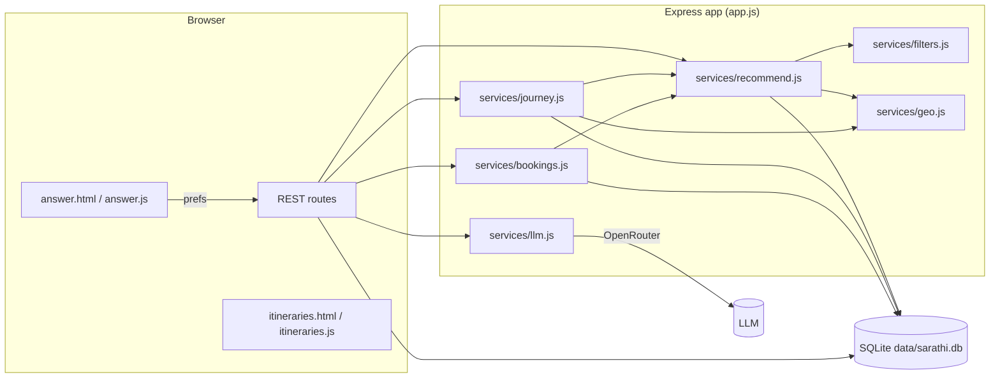
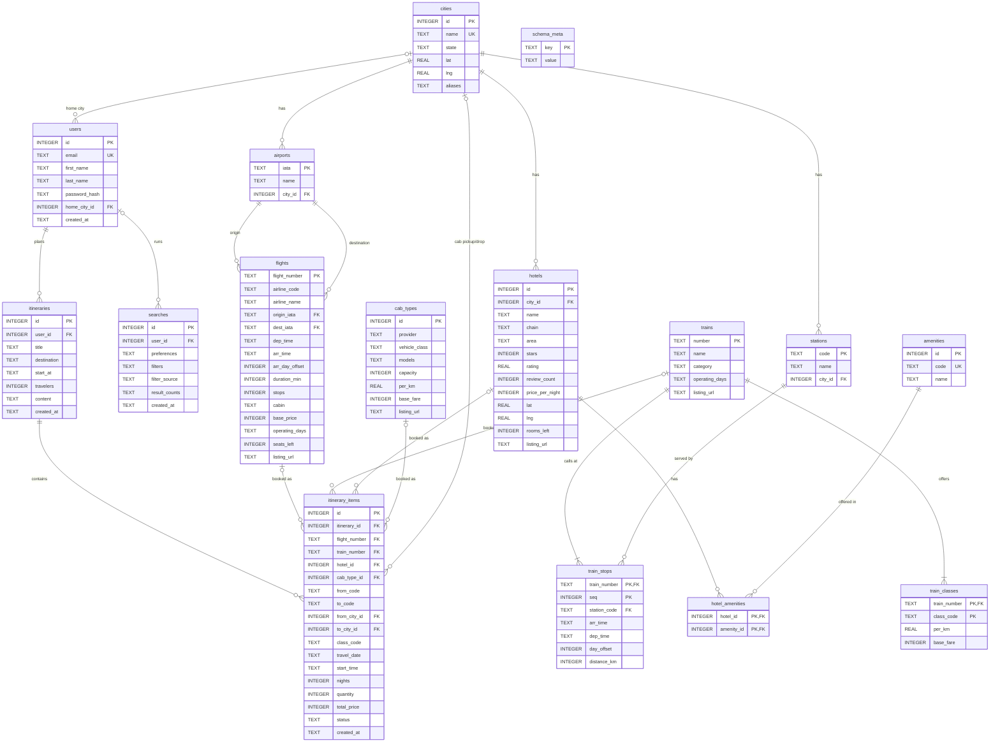
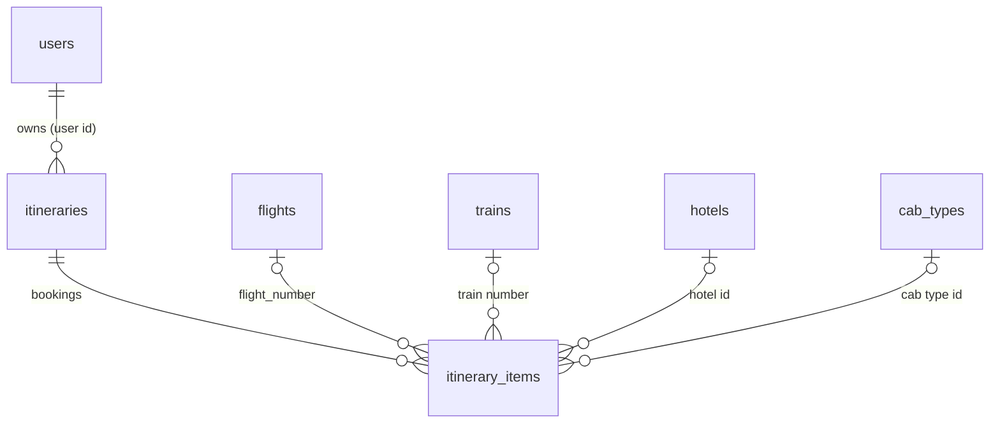

# Sarathi: Database & Recommendation System Report

This report describes everything added to Sarathi on top of the original cloned app: the relational database, the
AI-to-database recommendation pipeline, multi-leg journey planning, bookings and trips, cabs, the new pages, and how
each part was tested. All file paths are relative to the repository root (`Sarathi/`).

> **Data disclaimer.** Airports, stations, train numbers and hotel names are real. Schedules, fares, ratings and prices
> are **generated sample data** (deterministic), except five train timetables (16589, 17309, 17310, 20607, 20608) taken
> from public timetable sites in Oct 2026, which should be re-verified on IRCTC/NTES before relying on them.

---

## Table of contents

1. [What the original app was](#1-what-the-original-app-was)
2. [What was added: overview](#2-what-was-added-overview)
3. [Architecture](#3-architecture)
4. [Database design](#4-database-design)
5. [Seeding and catalog data](#5-seeding-and-catalog-data)
6. [Migrations and versioning](#6-migrations-and-versioning)
7. [AI → JSON → database recommendation pipeline](#7-ai--json--database-recommendation-pipeline)
8. [Multi-leg journey planner](#8-multi-leg-journey-planner)
9. [Bookings, trips and the timeline](#9-bookings-trips-and-the-timeline)
10. [HTTP API reference](#10-http-api-reference)
11. [Frontend changes](#11-frontend-changes)
12. [Security and integrity](#12-security-and-integrity)
13. [Testing and verification](#13-testing-and-verification)
14. [Known limitations and next steps](#14-known-limitations-and-next-steps)
15. [File map](#15-file-map)

---

## 1. What the original app was

Sarathi was a small Node/Express app with a static HTML/CSS/JS frontend:

- Users signed up/in; accounts lived in a flat file, `data/users.json` (bcrypt-hashed passwords, express-session).
- A form (destination, dates, budget, travellers, interests, weather, pace, notes) was stored in the session.
- `POST /api/itinerary` sent a prompt to OpenRouter (an LLM) and displayed the free-text result.
- Unsplash photos were proxied for a mood board; the UI was available in English and Hindi.
- There was no origin city, no flight/train/hotel data, no database and nothing persisted besides users.

## 2. What was added: overview

| Area | Summary |
|---|---|
| **Database** | SQLite (built-in `node:sqlite`) with 16 tables (including a small metadata table), enforced keys, CHECKs, UNIQUEs and indexes. |
| **Catalog data** | 22 cities, 18 airports, 24 stations, 324 flights, 37 trains (95 stops, 104 class fares), 6 cab products, 140 hotels with 15 amenity types. |
| **AI → JSON filters** | The LLM turns free-text preferences into a fixed-schema JSON filter; the server validates it and queries the database. |
| **Recommendations** | Ranked flights, trains, cabs and hotels, with price-cap relaxation and explanatory notes. |
| **Journey planner** | Deterministic route search that designs multi-leg trips (cab → train → cab → hotel → train → train) from the AI's constraints. |
| **Bookings & trips** | Details windows, Book now, named trips (many per destination), batch booking, inventory, cancellation, provider listing links. |
| **My Trips page** | `/itineraries`: list of trips, and per-trip timeline of departures, arrivals, check-ins and check-outs. |
| **UI fixes** | Itinerary card fills its box and scrolls; AI text is rendered as safe Markdown (no raw `**`/`###`). |
| **Auth storage** | Users moved from `users.json` to the database (one-time import). |

## 3. Architecture



**Request flow for one search**

1. Browser posts the form to `POST /api/preferences` (session) then `POST /api/recommendations`.
2. `llm.extractFilters` asks the model for a JSON filter object (schema in `services/filters.js`). On failure it retries
   once, then falls back to rule-based extraction (`heuristicFilters`).
3. `recommend()` **sanitises** every field (whitelists, coercion, canonical city names) and runs parameterised SQL.
4. If the AI returned a `trip` object, `proposeJourney()` searches for a multi-leg route and `planJourney()` chains and
   times each leg and picks concrete options.
5. The response contains the validated filters, ranked lists, the journey plan and notes. The chosen picks are stored in
   the session and fed to the itinerary prompt so the written plan uses real times.
6. The user opens details, books a single item or the whole journey; rows land in `itineraries` / `itinerary_items`.

## 4. Database design

### 4.1 Engine and conventions

- **SQLite** via Node's built-in `node:sqlite` (`DatabaseSync`), file `data/sarathi.db` (override with `SARATHI_DB_PATH`).
  WAL journal mode and `PRAGMA foreign_keys = ON` are set on every connection (`db/index.js`).
- SQL is written to stay portable to PostgreSQL/MySQL (no SQLite-only features except `instr`, `strftime` defaults and
  `COLLATE NOCASE`, each with a standard equivalent).
- Times are `'HH:MM'` strings; date-times are local wall-clock `'YYYY-MM-DDTHH:MM'`; money is whole INR integers.
- Business-rule integrity lives in the schema (FKs, CHECKs, UNIQUEs); the application relies on it rather than duplicating it.

### 4.2 Entity-relationship diagram



**The core entities (the model you asked for).** One table each for users, flights, trains, hotels and itineraries,
with the itinerary linking them:



| Entity | Primary key |
|---|---|
| `users` | `id` (auto-increment user id), `email` is also unique and case-insensitive |
| `flights` | `flight_number` |
| `trains` | `number` |
| `hotels` | `id` (hotel id); `(city_id, name)` is also unique |
| `itineraries` | `id`; `(user_id, title)` unique, case-insensitive |
| `itinerary_items` (the link table) | `id`; exactly one of flight / train / hotel / cab per row |

`cab_types` is a sixth catalog table added for cab legs. `train_stops`, `train_classes`, `hotel_amenities`, `amenities`,
`airports`, `stations` and `cities` are supporting tables that normalise the core entities.

### 4.3 Table reference

#### Reference data

| Table | Columns / constraints | Purpose |
|---|---|---|
| `cities` | `id` PK; `name` UNIQUE; `state`; `lat`,`lng` with range CHECKs; `aliases` (comma list, e.g. "Bangalore", "Madgaon") | Canonical places. Lat/lng drive cab distance. |
| `airports` | `iata` PK (CHECK length 3); `city_id` FK → cities ON DELETE CASCADE; index on `city_id` | Maps IATA codes to cities. Goa has two (GOI, GOX). |
| `stations` | `code` PK; `city_id` FK CASCADE; index on `city_id` | Railway stations. Bengaluru has SBC and YPR; Goa has MAO and VSG. |
| `amenities` | `id` PK; `code` UNIQUE; `name` | 15 amenity types (wifi, pool, spa, beach, …). |

#### Flights

`flights` has `flight_number` PK; `origin_iata`/`dest_iata` FK → airports (CHECK they differ); `dep_time`, `arr_time`,
`arr_day_offset` (CHECK 0 or 1); `duration_min` > 0; `stops` ≥ 0; `cabin` CHECK in (economy, premium_economy, business);
`base_price` > 0; `operating_days` (ISO weekdays, "1234567"); `seats_left` ≥ 0 (decremented on booking);
`listing_url` (airline booking site). Index `idx_flights_route (origin_iata, dest_iata, base_price)`.

#### Trains (three tables)

- `trains`: `number` PK, `name`, `category` CHECK in (Rajdhani, Shatabdi, Vande Bharat, Superfast, Mail/Express),
  `operating_days`, `listing_url` (IRCTC).
- `train_stops`: composite PK `(train_number, seq)`; `station_code` FK; UNIQUE `(train_number, station_code)`;
  `arr_time` (NULL at origin), `dep_time` (NULL at terminus), `day_offset`, `distance_km`. Index on
  `(station_code, train_number)`. A journey between two stops is any pair with `seq` ascending, so intermediate
  boarding points work (e.g. Agra → Delhi on a Bhopal train).
- `train_classes`: PK `(train_number, class_code)`, class CHECK in (SL, 3A, 2A, 1A, CC, EC); fare =
  `base_fare + per_km × (distance between the two stops)`.

#### Hotels

- `hotels`: `id` PK; `city_id` FK; `stars` CHECK 1–5; `rating` CHECK 0–5; `price_per_night` > 0; `rooms_left` ≥ 0;
  `listing_url`; UNIQUE `(city_id, name)`; indexes on `(city_id, price_per_night)` and `(city_id, stars)`.
- `hotel_amenities`: many-to-many, composite PK `(hotel_id, amenity_id)`, both FKs CASCADE.

#### Cabs

`cab_types`: `id` PK; `provider`, `vehicle_class`, `models`; `capacity` ≥ 1; `per_km` > 0; `base_fare`; `listing_url`;
UNIQUE `(provider, vehicle_class)`. Six rows: Savaari hatchback/sedan/SUV/Tempo Traveller and Uber Intercity sedan/SUV.
The fare for a ride is `base_fare + per_km × road km`, multiplied by the number of vehicles
(`ceil(travellers / capacity)`). Distance is computed from city coordinates, not stored.

#### Users and activity

- `users`: `id` PK; `email` UNIQUE COLLATE NOCASE; `password_hash` (bcrypt); optional `home_city_id` FK (SET NULL).
- `searches`: audit log of every recommendation request: raw `preferences` (JSON), validated `filters` (JSON),
  `filter_source` CHECK in (`llm`, `heuristic`), `result_counts` (JSON), nullable `user_id`.
- `itineraries` (a **trip**): `title` (user-chosen, UNIQUE per user, case-insensitive), `destination`, `start_at`
  (earliest departure/check-in among its bookings, maintained automatically), `travelers`, `content` (the AI day-by-day
  plan, as Markdown), FK `user_id` CASCADE. Indexes: unique `(user_id, title COLLATE NOCASE)` and `(user_id, start_at)`.
- `itinerary_items` (a **booking**): see below.

#### `itinerary_items`: how a trip links to bookings

```sql
CHECK ((flight_number IS NOT NULL) + (train_number IS NOT NULL)
     + (hotel_id IS NOT NULL) + (cab_type_id IS NOT NULL) = 1)
```

Each row points to **exactly one** flight, train, hotel or cab product, enforced by the database. Other columns:

| Column | Used by | Meaning |
|---|---|---|
| `from_code`, `to_code` | train | boarding / alighting station codes |
| `from_city_id`, `to_city_id` | cab | pickup / drop cities (FK → cities) |
| `class_code` | train | booked class |
| `travel_date` | all | departure date (hotel: check-in) |
| `start_time` | cab | pickup time `HH:MM` |
| `nights` | hotel | length of stay |
| `quantity` | all | passengers, rooms (hotel) or vehicles (cab) |
| `total_price` | all | **price snapshot at booking time**, immune to later fare changes |
| `status` | all | `booked` or `cancelled` (CHECK) |

`ON DELETE CASCADE` from `itineraries` removes a trip's bookings with it. Cancelling is a status change, so history is kept.

#### `schema_meta`

Key/value table holding `schema_version` (currently `4`), `catalog_version` (currently `2`) and
`legacy_users_migrated`. It drives migrations and automatic re-seeding.

### 4.4 Index summary

`idx_airports_city`, `idx_stations_city`, `idx_flights_route`, `idx_stops_station`, `idx_hotels_city`,
`idx_hotels_city_stars`, `idx_searches_user`, `idx_itineraries_user_title` (unique), `idx_itineraries_user`,
`idx_items_itinerary`. Primary keys and UNIQUE constraints add their own implicit indexes.

## 5. Seeding and catalog data

Files: `db/seed-data.js` (static reference data), `db/seed.js` (generator), `db/index.js` (auto-seed on first boot).
Run `npm run seed` to reload the catalog by hand.

**Determinism.** A seeded PRNG (mulberry32, seed `20260101`) generates flights and hotel attributes, so every run gives
identical rows and stable keys. That matters because bookings reference flights/hotels by key.

**What is generated and how**

- **Cities, airports, stations**: static lists. 22 cities; Vellore, Londa, Mysuru, Sangli were appended last so existing
  hotel ids (assigned in city order) never shift.
- **Flights (324)**: all hub pairs among DEL, BOM, BLR, MAA, CCU, HYD get 5-7 daily flights; smaller airports connect
  only to DEL/BOM/BLR with 2-3. Airlines: IndiGo, Air India, Air India Express, Akasa, SpiceJet. Price ≈
  `(1700 + 3.4 × km) × airline factor × time-of-day factor × jitter`; Air India has premium/business cabins; ~30% of
  long non-hub routes have one stop. Flight numbers are unique because `flight_number` is the primary key.
- **Trains (37)**: real train names/numbers with approximate times, stored as stops. Distance between stops is
  `haversine × 1.2`. Fares come from per-category per-km rates (Rajdhani, Shatabdi, Vande Bharat, Superfast, Mail/Express).
  Five trains use public timetable data (see disclaimer). They make the Vellore → Goa demo corridor possible:
  16589 (Bengaluru → Londa), 17309/17310 (Yesvantpur ↔ Vasco via Londa and Madgaon), 20607/20608 (Vande Bharat via Katpadi).
- **Hotels (140)**: real properties per city (Taj, Oberoi, ITC, Leela, Hyatt, Marriott, Lemon Tree, Zostel, …) plus
  two generic budget listings per city (Treebo, OYO). Price = star base × per-property multiplier × city factor × jitter;
  rating by star band; amenities derived from stars plus per-property extras.
- **Cabs (6)**: per-km rates are realistic intercity ranges.
- **`listing_url`**: airline sites; IRCTC for trains; hotel-chain sites (a web search for chains with no mapped site);
  cab-provider sites. These are provider home/booking pages, **not deep links to one flight or room** (that needs
  partner APIs). The column exists so real deep links can be dropped in.

**Safe reloads.** `seed()` turns foreign keys off, deletes catalog rows, reinserts, turns them back on and runs
`PRAGMA foreign_key_check`. Existing bookings survive because keys are deterministic. Reseeding resets
`seats_left`/`rooms_left` but keeps users, searches, trips and bookings. `init()` reseeds automatically when the stored
`catalog_version` differs from `CATALOG_VERSION` in `db/seed.js`.

## 6. Migrations and versioning

There is no migration framework; `db/index.js` runs idempotent steps on every start, before applying `schema.sql`
(which is all `CREATE ... IF NOT EXISTS`):

| Version | Change | How it is migrated |
|---|---|---|
| v1 → v2 | `flights` keyed by `flight_number`; `saved_items` replaced by `itinerary_items` | Old `flights` and `saved_items` are dropped (catalog is re-seeded); `itineraries` gains `title`, `travelers`. |
| v2 → v3 | `listing_url` on flights/trains/hotels; trip names unique per user; `itineraries.start_at` | `ALTER TABLE ADD COLUMN`; blank titles backfilled as "Trip to X"; later duplicates suffixed `#id`; unique index created afterwards. |
| v3 → v4 | Cabs: `itinerary_items` needs a 4-way CHECK and new columns | Table rebuilt: rename old table, create new from `schema.sql`, copy rows in a transaction, drop old. |
| catalog 1 → 2 | Corridor trains, new cities/stations, `cab_types` | Auto re-seed via `catalog_version`. |
| users.json | Original flat-file accounts | Imported once on first boot (`legacy_users_migrated` flag); bcrypt hashes preserved. |

Each migration was tested on throw-away copies of old-layout databases, including one with existing bookings, and the
v4 migration was dry-run against a copy of the live database before the live server was restarted.

## 7. AI → JSON → database recommendation pipeline

### 7.1 The filter contract (`services/filters.js`)

The model must reply with one JSON object matching `FILTER_SCHEMA`:
`origin`, `destination`, `date`, `nights`, `travelers`, `modes` (flight/train/cab/hotel), `budget_total_inr`,
`transport` (`max_price_inr`, `max_duration_min`, `max_stops`, `depart_after`, `depart_before`, `cabin`,
`train_classes`), `hotel` (`min_stars`, `max_stars`, `min_rating`, `max_price_per_night_inr`, `amenities`), `sort`
(best/price/duration/rating), `limit`, and an optional `trip` object (§8).

### 7.2 Calling the model (`services/llm.js`)

- OpenRouter chat completions with `response_format: json_object`. The system prompt contains the schema and rules
  ("null for anything unspecified", how to interpret "luxury"/"cheap", when to fill `trip`).
- The user message carries today's date (so "28 November" resolves to the right year), the list of known cities and the
  raw preferences.
- Output is cleaned (`parseJsonObject` strips code fences/prose and takes the outermost `{...}`). Up to two attempts;
  after that `heuristicFilters` extracts dates, budget (`50k`, `1.5 lakh`), stars, amenities, "direct", "morning", etc.
  with plain rules. `SARATHI_LLM_MOCK=1` forces the heuristic path (offline testing).
- `generateItinerary` writes the day-by-day plan; when a journey exists, its legs are passed as plain-language lines
  ("Train: Bengaluru → Londa by 16589 …, departs 2026-11-28 23:00 …") and the model is told to build the plan around
  those exact times and not invent other transport.

### 7.3 Validation (`sanitizeFilters`)

Nothing the model says reaches SQL directly:

- Enumerations are whitelisted (modes, sorts, cabins, train classes, amenity codes); numbers are coerced and clamped;
  dates must be real calendar dates; times must match `HH:MM`.
- City text is resolved by `buildCityResolver` (name, alias, IATA code or station code, case-insensitive, first segment of
  "Goa, India") to a canonical name, or dropped.
- Unknown values become `null`/defaults. A hostile value such as `"Goa'; DROP TABLE hotels;--"` simply fails to resolve.
- All queries use bound parameters; only fixed column names and fixed SQL fragments are concatenated.

### 7.4 Querying and ranking (`services/recommend.js`)

| Category | Query highlights |
|---|---|
| Flights | Airports → city join; weekday via `instr(operating_days, ?)`; time-window, stops, cabin and price filters in SQL. |
| Trains | Self-join of `train_stops` (`sd.seq > so.seq`) with stations and class fares; fare computed in SQL; results grouped per train with a class/fare list. |
| Hotels | City, stars, rating, price, rooms available; amenities by **relational division** (`COUNT(DISTINCT code) = number requested`). |
| Cabs | Road distance from city coordinates; one product per cab type; vehicles = `ceil(travelers / capacity)`. |

- **Dynamic pricing (sample)**: flight price × 1.3 if departing in < 7 days, × 1.1 in < 21 days, × 0.92 beyond 60.
- **Budget caps**: when only a total budget is given, ~20% per one-way leg per person goes to transport and ~40% to hotel
  rooms per night. If a price cap empties a category, it is retried without the cap and a note explains it.
- **Ranking**: min-max normalised score. Transport: 50% price, 40% duration, 10% non-stop bonus. Hotels: 40% rating,
  35% price, 25% stars. `sort=price|duration|rating` overrides the score.
- Every request is logged in `searches` with the validated filters and result counts.

## 8. Multi-leg journey planner

Added so a request like *Vellore → Goa, exam ends 1 PM on the 28th, through Bengaluru, no stay there, back by 3 Dec*
produces a complete connected plan. Code: `services/journey.js`; constants in the file header.

### 8.1 Division of labour

The LLM supplies **constraints only**, in an optional `trip` object: `return_home`, `earliest_start`, `arrive_by`, `via`
(cities to pass through) and `prefer` (cheapest/fastest). The server designs the legs deterministically, so results are
repeatable and checkable against the database. (An earlier design let the model write the legs itself; on the demo input
it chose a flight, ignoring the budget, so it was replaced.)

### 8.2 Route search (`proposeJourney`)

A time-expanded, level-by-level label search over trains, flights and cabs:

- **State**: label = (city, arrival time, cost, legs, visited cities). A label is dropped when another in the same city is
  no later and no dearer. Cities are never revisited; at most 4 legs; no cab directly after a cab.
- **Edges**: train segments (every later stop on the same train, cheapest class), flights (seats must cover the group),
  and cabs to any city within 450 km (cheapest vehicle mix).
- **Connection rules**: minimum gap after arrival: train 75 min, flight 120 min, cab 15 min. Layovers capped at
  8 h and may **not cross midnight**, so there are no overnight stops in transit cities. This is what satisfies "no stay
  in Bengaluru". The first leg may wait up to 18 h (e.g. hotel check-out at 11:00 for a 23:35 train).
- **Outbound choice**: among routes that pass through any required `via` city, keep those arriving within 24 h of the
  fastest (or the fastest only when `prefer = fastest`) and take the **cheapest**.
- **Return choice**: for each possible departure day from the destination, search routes arriving home before
  `arrive_by`; prefer plans that arrive **on the last day**, then the lowest `transport + nights × cheapest room rate`;
  ties go to the later arrival.
- The result is an ordered list of legs: outbound legs, a hotel leg (check-in = arrival date), return legs.

### 8.3 Timing and option selection (`planJourney`)

The legs are then walked in order with a cursor (the traveller's next free moment):

- **Train/flight legs**: look up options on the leg's date, drop any departing before `cursor + buffer`, rank, and pin the
  exact train or flight the search chose. Alternatives (up to 5) are kept for the UI.
- **Cab legs**: pickup is computed after the whole walk. A cab that precedes a train/flight is **retimed to leave as late
  as possible while still arriving a station-buffer (75 min train, 120 min flight) early**, never before the traveller is free.
- **Hotel legs**: nights are **derived from the next dated leg** (the model's number is only a fallback). The nightly cap is
  `(budget − estimated transport) × 0.9 / nights / rooms` (floor: 20% of budget). If the requested amenities leave fewer
  than three hotels, the next best hotels are appended and a note says so.
- **Checks**: each leg must start where the previous one ended; deadlines are verified; failures become notes rather than being hidden.
- Output: legs with options, chosen option, departure/arrival times, total, start/end, notes, and `summarizeJourney` text
  for the itinerary prompt.

### 8.4 Worked example (the demo input)

Input: Vellore → Goa, 28 Nov – 3 Dec, ₹1,00,000, 9 travellers, "Exam ends at 1 PM on 28th … through Bengaluru, but no stay
in Bengaluru". The planner returned the same plan on every run:

| # | Leg | Option | Departs → arrives | Cost |
|---|---|---|---|---|
| 1 | Vellore → Bengaluru | Savaari Tempo Traveller cab (1 vehicle) | 28 Nov 17:08 → 21:45 | ₹6,008 |
| 2 | Bengaluru → Londa | 16589 Rani Chennamma Express, SL | 28 Nov 23:00 → 29 Nov 07:58 | ₹2,889 |
| 3 | Londa → Goa | Savaari Tempo Traveller cab | 29 Nov 08:13 → 10:14 | ₹2,966 |
| 4 | Stay in Goa | Zostel Goa, 5 rooms, 3 nights | 29 Nov 14:00 → 2 Dec 11:00 | ₹17,250 |
| 5 | Goa → Bengaluru | 17310 Vasco da Gama – Yesvantpur Express, SL (from Madgaon) | 2 Dec 23:35 → 3 Dec 12:35 | ₹3,186 |
| 6 | Bengaluru → Vellore | 20608 Vande Bharat, CC | 3 Dec 14:50 → 17:33 (Katpadi) | ₹4,500 |

Total ≈ ₹36,799. The hotel is a hostel because "Beach" is a hard amenity filter and only one hotel inside the remaining
budget matches; two others are listed as alternatives.

## 9. Bookings, trips and the timeline

Code: `services/bookings.js`; UI: `public/js/answer.js` (booking) and `public/js/itineraries.js` (trips).

### 9.1 Details

`GET /api/details/:type/:ref` returns the full record for the details window: flight airports/seats; train **every stop**
with times/distances and per-class fares for the chosen segment; hotel full amenity list; cab vehicle, distance and
vehicles needed. Prices are recomputed for the requested travellers/date/nights.

### 9.2 Booking rules

Everything is validated and priced **on the server**; the client only says *what* and *when*:

- A travel date is required, valid and not in the past; flights/trains must operate on that weekday.
- Flights decrement `seats_left` with `UPDATE ... WHERE seats_left >= ?`; hotels decrement `rooms_left` the same way, so
  overbooking is impossible even with concurrent requests. Insufficient stock returns HTTP 409.
- Train bookings check the station order (boarding before alighting) and the class.
- Cab bookings need pickup/drop cities and a `HH:MM` pickup time.
- Single bookings run in one transaction; **batch** bookings (`/api/bookings/batch`) book every leg of a journey in one
  all-or-nothing transaction.
- `DELETE /api/bookings/:id` marks the item cancelled, restores seats/rooms and recomputes the trip start. Only the owner can cancel.

### 9.3 Trips (itineraries)

- Users can create **many trips to the same destination**. Each has a **unique name chosen by the user** (case-insensitive).
  A blank name is rejected; a duplicate returns HTTP 409.
- In the details window the user picks an existing trip or **+ New trip…** and types a name. "Book entire journey" asks for a name too.
- The AI-written plan text from the session is attached to a trip when its destination matches, so My Trips can show it.
- `itineraries.start_at` = earliest departure/check-in among active bookings, recomputed after every booking and cancellation.

### 9.4 The timeline

For each active booking the server generates events and sorts them chronologically:

| Booking | Events |
|---|---|
| Flight | departure at `date + dep_time`; arrival at `date + arr_time (+1 day if overnight)` |
| Train | departure at the boarding station; arrival at the alighting station with the correct day offset |
| Cab | pickup at `start_time`; drop at pickup + duration (road km ÷ 45 km/h) |
| Hotel | check-in 14:00; check-out 11:00 after the last night |

The My Trips page shows these grouped by day with icons, plus the booking cards (price, "Open listing ↗", Cancel) and the AI plan.

### 9.5 Provider redirect

After a single **Book now**, the browser opens a tab on the item's `listing_url` (opened synchronously in the click handler
so pop-up blockers allow it, then pointed at the provider) while the current tab goes to the trip page. If the tab is blocked,
only the trip page opens. Every booking card has an **Open listing** link.

## 10. HTTP API reference

| Method & path | Auth | Purpose |
|---|---|---|
| `POST /api/signup`, `POST /api/login`, `POST /api/logout`, `GET /api/session` | - | Accounts (now stored in SQLite; emails normalised to lower case). |
| `POST /api/preferences`, `GET /api/preferences` | - | Session form data, now including `origin`. |
| `POST /api/recommendations` | - | AI filters → ranked flights/trains/cabs/hotels and, when applicable, the journey plan. |
| `POST /api/itinerary`, `GET /api/itinerary/latest` | - | Generate / fetch the AI day-by-day plan (uses the real picks). |
| `GET /api/cities` | - | City names for the origin autocomplete. |
| `GET /api/details/:type/:ref` | - | Full record for the details window (`type` = flight/train/hotel/cab). |
| `POST /api/bookings` | login | Book one item: `type`, `ref`, `date`, plus `itinerary_id` **or** `new_trip_name`. |
| `POST /api/bookings/batch` | login | Book several items into one trip, atomically. |
| `DELETE /api/bookings/:id` | login | Cancel and restore inventory. |
| `GET /api/itineraries[?summary=1]` | login | Trips with bookings and timelines (summary: id/title/destination/start only). |
| `GET /api/destination-media`, `GET /api/unsplash` | - | Unchanged (Unsplash proxy). |
| `GET /itineraries` | - | The My Trips page (redirects to login if the API returns 401). |

Error handling: `BookingError` carries an HTTP status (400 validation, 404 not found, 409 conflict/stock); unexpected
errors return a generic 500 and are logged.

## 11. Frontend changes

- **Planner (`answer.html` / `answer.js`)**: "Departing from" field with a city datalist; itinerary card that fills its box and scrolls;
  Markdown rendering; recommendations section; clickable cards → details modal (travellers, date, nights, class, pickup
  time, trip chooser, live price); journey section (leg cards, per-leg alternatives with a connection warning, total, trip name, **Book entire journey**).
- **Markdown (`public/js/markdown.js`)**: a small DOM-building renderer for headings, bold, italic, code, bullet and numbered
  lists, rules and paragraphs. It uses `textContent` only, never `innerHTML`, so model output cannot inject markup. It is shared by the planner, the full-itinerary modal and My Trips.
- **Layout fix**: the card used `max-height: 420px` while the form column was taller. It now uses `height: 0; min-height: 100%` so it fills the
  row without stretching it, and the content area scrolls; on narrow screens it falls back to a normal flow.
- **My Trips (`itineraries.html` / `itineraries.js`)**: trip cards sorted by start time, hash routing (`#trip-<id>`), timeline, bookings, plan.
- **Fixes along the way**: a wrong SRI hash that blocked the html2pdf script (so PDF export never loaded); the "generated by GPT-5-mini" label
  was removed (the model is configurable).
- **i18n**: new English and Hindi keys for the origin field, recommendations header, My Trips link/page. The journey, cab and booking
  strings are English only for now.

## 12. Security and integrity

- **SQL injection**: bound parameters everywhere; whitelisting of every AI/client-supplied enum; identifiers are never interpolated from user input.
  Tested with malicious city names, amenities, stars, times, sort keys, booking refs and nights.
- **XSS**: all model and database text is inserted with `textContent`/DOM APIs.
- **Passwords**: bcrypt hashes retained; login errors are generic.
- **Authorisation**: bookings, trips and cancellation are scoped to the session user; foreign trip ids return 404.
- **Concurrency and consistency**: stock decrements are conditional updates inside transactions; batch bookings are all-or-nothing;
  uniqueness is enforced by the database, not just the UI.
- **Secrets**: `.env` is git-ignored; keys were validated without printing them. `SARATHI_SESSION_SECRET` should be changed from the placeholder before deployment.

## 13. Testing and verification

All tests ran against scratch databases (`SARATHI_DB_PATH`) and alternate ports so the live database was not touched.

| Area | What was checked |
|---|---|
| Seed | Row counts, deterministic reload, `PRAGMA foreign_key_check` clean, CHECK constraint rejects a 9-star hotel. |
| Auth | Signup, duplicate/case-variant email, bad login, login, logout; legacy `users.json` import. |
| Filters | Departure window, train class, stars, amenities (relational division), price caps and relaxation, return-direction train matching, intermediate-stop boarding. |
| Injection | Malicious strings in every filter and booking field; tables stayed intact. |
| Real model | Key validity (OpenRouter, Unsplash), invalid model id detected, real filter extraction, itinerary generation using real picks. |
| Bookings | Flight/hotel/train/cab booking, wrong class, reversed route, past date, overbooking (409), injection in `nights`/`ref`, duplicate trip name, same-destination second trip, cancellation restoring stock, trip start recomputed. |
| Timeline | Chronological order across days, overnight arrivals, hotel check-in/out, cab legs. |
| Migrations | v1 → v2, v2 → v3 (with duplicate/blank titles), v3 → v4 (with existing bookings), live-database copy, `foreign_key_check`. |
| Demo scenario | The Vellore → Goa input run through the real model repeatedly; identical six-leg plan every time (§8.4). |
| Browser | Playwright (Chromium): markdown rendering and card fill at 1280 px and 600 px; a full run: sign up, fill the form, generate, book the entire journey with a trip name, land on the trip page, read the timeline and booking cards. Screenshots reviewed. |

## 14. Known limitations and next steps

- **Sample data**: fares, prices, ratings, seats and most train times are generated. Verify the five real timetables on IRCTC/NTES.
- **Listing links** go to provider sites, not specific flights/rooms; real deep links need partner/affiliate access.
- **Yesvantpur vs KSR Bengaluru**: train 17310 ends at Yesvantpur; the planner treats both as "Bengaluru" and assumes the transfer fits in the 75-minute rail buffer.
- **No payment or provider confirmation**; "booking" records the plan and reserves sample inventory.
- **Sessions** use the default in-memory store (lost on restart; not for production). No CSRF protection or rate limiting.
- **Search model**: one-way segments only except the journey planner's return leg; no multi-city (>1 destination) trips; hotel check-in/out times are fixed assumptions (14:00/11:00).
- **Cab model**: straight-line distance × 1.25 and 45 km/h; no tolls, night charges or driver allowances.
- **Hindi translations** for the journey, cab and booking UI are still to be added.
- **Ideas**: deep links via partner APIs, editable trips (rename, move a booking, reschedule), real-time availability, PostgreSQL deployment (the schema is portable), automated test suite and CI (verification so far has been scripted and manual).

## 15. File map

| Path | Role |
|---|---|
| `app.js` | Express routes (auth, preferences, recommendations, details, bookings, trips, itinerary). |
| `db/schema.sql` | Full relational schema. |
| `db/index.js` | Connection, PRAGMAs, migrations (v1-v4), auto-seed, legacy user import, user repository. |
| `db/seed-data.js`, `db/seed.js` | Reference data and deterministic generator; `npm run seed`. |
| `services/filters.js` | Filter schema shown to the LLM, sanitiser, `trip` sanitiser, heuristic fallback. |
| `services/llm.js` | OpenRouter client, filter extraction with retry/fallback, itinerary generation. |
| `services/recommend.js` | City resolver, flight/train/hotel/cab queries, pricing, ranking, relaxation. |
| `services/journey.js` | Route search, journey timing and option selection, itinerary summary. |
| `services/bookings.js` | Details, booking, batch booking, cancellation, trips, timeline, start-time maintenance. |
| `services/geo.js` | Haversine distance, road factor, cab duration, cab range. |
| `public/answer.html`, `public/js/answer.js` | Planner UI, details modal, journey UI. |
| `public/itineraries.html`, `public/js/itineraries.js` | My Trips page. |
| `public/js/markdown.js` | Safe Markdown renderer. |
| `public/css/styles.css` | Styles for all of the above. |
| `public/i18n/en.json`, `hi.json` | Added keys. |
| `README.md` | Short run/usage guide. |
| `report.md` | This document. |

*Counts in this report come from the live database after the v4 upgrade: 22 cities, 18 airports, 24 stations, 324 flights,
37 trains, 95 train stops, 104 train class fares, 6 cab types, 140 hotels, 15 amenities, 875 hotel-amenity links.*
