# Sarathi: AI-Powered Travel Planning on a Relational Database

**Database Systems Lab Project Report**

---

## 1. Project Title

| | |
|---|---|
| **Project name** | Sarathi: an AI-powered travel planner backed by a relational DBMS (flights, trains, cabs, hotels, users, trips and bookings) |
| **Student names and register numbers** | **Siddhant Kumar – 24BCT0062**<br>**Mehul Jain – 24BCT0024** |
| **Course code** | BCSE302L – Database Systems *(lab component BCSE302P)* |
| **Faculty name** | **Nithya N S** |
| **Repository** | https://github.com/RPi-Boy/Sarathi (branch `feature/dbms-recommendations-bookings`) |

> **Data disclaimer.** Airports, stations, train numbers and hotel names are real. Schedules, fares, ratings and prices are
> **generated sample data**, except five train timetables (16589, 17309, 17310, 20607, 20608) taken from public timetable
> sites in Oct 2026, which should be re-verified on IRCTC/NTES before being relied on.

## Contents

1. [Project Title](#1-project-title)
2. [Introduction](#2-introduction)
3. [Objectives](#3-objectives)
4. [Software Requirements](#4-software-requirements)
5. [Database Design](#5-database-design)
6. [Database Creation and Sample Data](#6-database-creation-and-sample-data)
7. [Database Operations and Outputs](#7-database-operations-and-outputs)
8. [Advanced Database Features](#8-advanced-database-features)
9. [Project Output Screenshots](#9-project-output-screenshots)
10. [Conclusion](#10-conclusion)
11. [References](#11-references)
- [Appendix A: Implementation details](#appendix-a-implementation-details)

---

## 2. Introduction

### 2.1 Brief description of the project

Sarathi is a web application that plans trips. A traveller describes a journey in plain language: where from, where to,
dates, budget, group size, interests and special notes ("exam ends at 1 PM on the 28th, travel through Bengaluru, no stay
there"). An AI model turns this into a structured JSON filter; the application then **queries a relational database** of
flights, trains, cabs and hotels, ranks the matches, designs a connected multi-leg route, and lets the user book it into a
named trip. Each trip shows a timeline of departures, arrivals, check-ins and check-outs, and links to the provider's site.

The original application only asked an AI for a free-text itinerary and stored users in a flat JSON file. This project adds
a complete database management system underneath it, together with the application logic that uses it.

### 2.2 Purpose of the database system

- Store **users, flights, trains, hotels, cabs, trips and bookings** in one consistent, constrained schema instead of ad-hoc files.
- Make recommendations **verifiable**: the AI only proposes filters; the data it returns comes from the database, so every
  flight, fare and room can be traced to a row.
- Guarantee integrity (no double-booked seats, no orphan bookings, unique emails and trip names) with keys, constraints,
  transactions and triggers rather than relying on application code alone.
- Support multi-modal journeys (cab + train + flight + hotel) with realistic timing, which needs relational modelling of train stops, fares and distances.

## 3. Objectives

### 3.1 Main objectives

1. Design a normalised relational schema for users, flights, trains, hotels and itineraries, linked through a bookings table.
2. Populate it with deterministic dummy data based on real airports, stations, trains and hotels.
3. Let an AI return a **JSON filter** that is validated and used to query and rank recommendations.
4. Implement bookings with inventory control, named trips, cancellation, timelines and provider links.
5. Demonstrate SQL operations (SELECT, INSERT, UPDATE, DELETE, JOIN, aggregates, subqueries), views, triggers, functions and transactions.

### 3.2 Problems addressed

| Problem | How the system addresses it |
|---|---|
| Users, trips and bookings lived in a flat file with no integrity | One relational database with primary/foreign keys, UNIQUE and CHECK constraints |
| AI answers were unverifiable free text | AI output is constrained to a JSON schema, validated, and used only to query real rows |
| No flight, train or hotel data and no origin city | Normalised catalog tables (22 cities, 324 flights, 37 trains, 140 hotels, 6 cab products) |
| Real trips need several connected legs (e.g. cab → train → cab → hotel → train) | Route search over the train-stop graph, flights and cabs with layover and midnight rules |
| Double bookings and inconsistent stock | Conditional updates inside transactions; batch bookings are all-or-nothing |
| No record of what was booked and when | `itineraries` / `itinerary_items` with price snapshots, an audit table filled by triggers, and a timeline view |
| SQL injection through AI or user input | Whitelisting of every AI field and bound parameters in every query |

## 4. Software Requirements

### 4.1 Database used

**SQLite 3.53** through Node.js's built-in `node:sqlite` module (`DatabaseSync`), stored in `data/sarathi.db`.
It is a relational (SQL) DBMS; no NoSQL store is used. The SQL was kept portable to PostgreSQL/MySQL.
Foreign keys and WAL journaling are enabled on every connection.

### 4.2 Programming languages and tools

| Layer | Tools |
|---|---|
| Language / runtime | JavaScript (CommonJS) on **Node.js v26.10**, npm 12.2 |
| Web framework | Express 5.2, express-session 1.18 |
| Security | bcryptjs 3 (password hashing) |
| AI | OpenRouter chat-completions API (model configurable via `GEMINI_MODEL`, tested with `google/gemini-3.5-flash`) |
| Images | Unsplash API (server-side proxy) |
| HTTP client / config | node-fetch 2, dotenv 17 |
| Frontend | Plain HTML, CSS and JavaScript (ES modules); a small custom Markdown renderer |
| Testing | curl, Node scripts against scratch databases, Playwright (Chromium) for browser tests and screenshots |
| Diagrams | Mermaid (ER and architecture diagrams, rendered by GitHub and most Markdown viewers) |
| OS / version control | Linux (Arch), Git and GitHub |

## 5. Database Design

### 5.1 Engine and conventions

- **SQLite** via Node's built-in `node:sqlite` (`DatabaseSync`), file `data/sarathi.db` (override with `SARATHI_DB_PATH`).
  WAL journal mode and `PRAGMA foreign_keys = ON` are set on every connection (`db/index.js`).
- SQL is written to stay portable to PostgreSQL/MySQL (no SQLite-only features except `instr`, `strftime` defaults and
  `COLLATE NOCASE`, each with a standard equivalent).
- Times are `'HH:MM'` strings; date-times are local wall-clock `'YYYY-MM-DDTHH:MM'`; money is whole INR integers.
- Business-rule integrity lives in the schema (FKs, CHECKs, UNIQUEs); the application relies on it rather than duplicating it.

### 5.2 Entity-relationship (ER) diagram

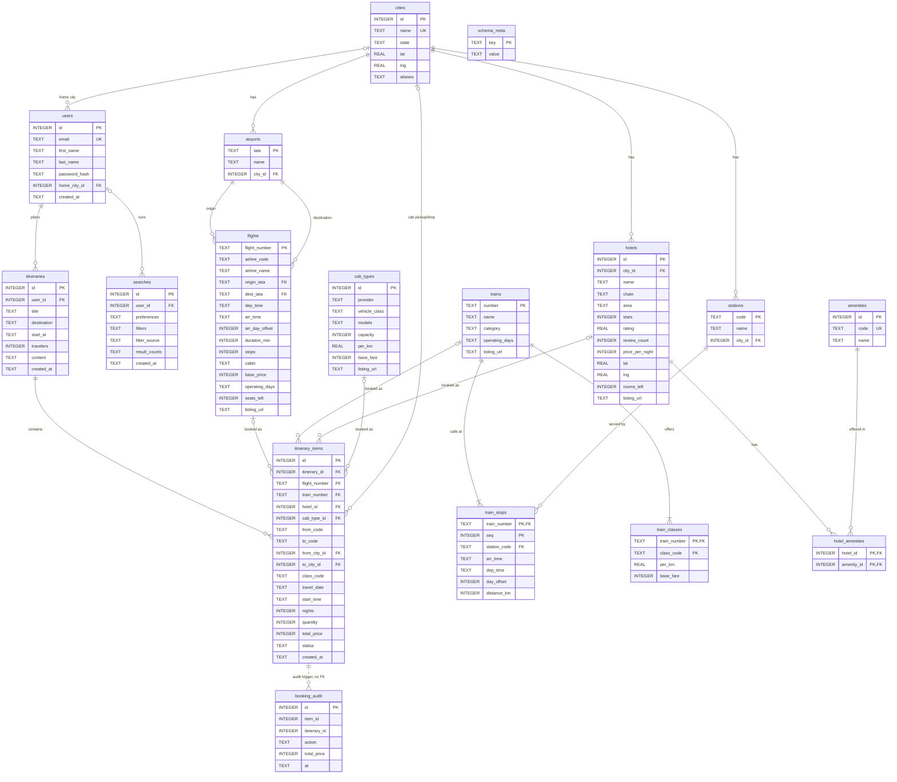

**The core entities (the model you asked for).** One table each for users, flights, trains, hotels and itineraries,
with the itinerary linking them:

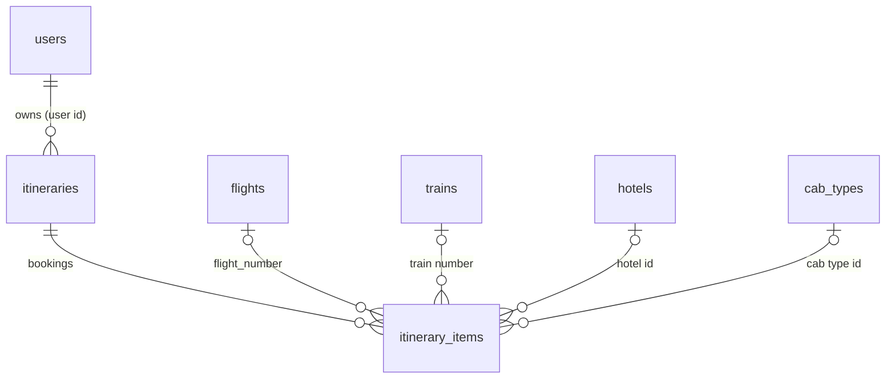

| Entity | Primary key |
|---|---|
| `users` | `id` (auto-increment user id), `email` is also unique and case-insensitive |
| `flights` | `flight_number` |
| `trains` | `number` |
| `hotels` | `id` (hotel id); `(city_id, name)` is also unique |
| `itineraries` | `id`; `(user_id, title)` unique, case-insensitive |
| `itinerary_items` (the link table) | `id`; exactly one of flight / train / hotel / cab per row |

`cab_types` is a sixth catalog table added for cab legs. `train_stops`, `train_classes`, `hotel_amenities`, `amenities`,
`airports`, `stations` and `cities` are supporting tables that normalise the core entities.

### 5.3 Relational schema (tables, attributes, primary keys, foreign keys)

PK = primary key, FK = foreign key. Composite keys are written `(a, b)`.

| Table | Attributes | Primary key | Foreign keys | Other unique keys |
|---|---|---|---|---|
| `cities` | id, name, state, lat, lng, aliases | id | | name |
| `airports` | iata, name, city_id | iata | city_id → cities.id | |
| `stations` | code, name, city_id | code | city_id → cities.id | |
| `users` | id, email, first_name, last_name, password_hash, home_city_id, created_at | id | home_city_id → cities.id | email (NOCASE) |
| `searches` | id, user_id, preferences, filters, filter_source, result_counts, created_at | id | user_id → users.id | |
| `itineraries` | id, user_id, title, destination, start_at, travelers, content, created_at | id | user_id → users.id | (user_id, title NOCASE) |
| `flights` | flight_number, airline_code, airline_name, origin_iata, dest_iata, dep_time, arr_time, arr_day_offset, duration_min, stops, cabin, base_price, operating_days, seats_left, listing_url | flight_number | origin_iata, dest_iata → airports.iata | |
| `trains` | number, name, category, operating_days, listing_url | number | | |
| `train_stops` | train_number, seq, station_code, arr_time, dep_time, day_offset, distance_km | (train_number, seq) | train_number → trains.number; station_code → stations.code | (train_number, station_code) |
| `train_classes` | train_number, class_code, per_km, base_fare | (train_number, class_code) | train_number → trains.number | |
| `hotels` | id, city_id, name, chain, area, stars, rating, review_count, price_per_night, lat, lng, rooms_left, listing_url | id | city_id → cities.id | (city_id, name) |
| `amenities` | id, code, name | id | | code |
| `hotel_amenities` | hotel_id, amenity_id | (hotel_id, amenity_id) | hotel_id → hotels.id; amenity_id → amenities.id | |
| `cab_types` | id, provider, vehicle_class, models, capacity, per_km, base_fare, listing_url | id | | (provider, vehicle_class) |
| `itinerary_items` | id, itinerary_id, flight_number, train_number, hotel_id, cab_type_id, from_code, to_code, from_city_id, to_city_id, class_code, travel_date, start_time, nights, quantity, total_price, status, created_at | id | itinerary_id → itineraries.id; flight_number → flights; train_number → trains; hotel_id → hotels; cab_type_id → cab_types; from_city_id, to_city_id → cities | |
| `booking_audit` | id, item_id, itinerary_id, action, total_price, at | id | none (by design) | |
| `schema_meta` | key, value | key | | |

### 5.4 Relationships between the data

| Relationship | Cardinality | Notes |
|---|---|---|
| cities – airports / stations / hotels | 1 : N | An airport, station or hotel belongs to exactly one city; a city may have none (e.g. Agra has no airport). |
| airports – flights | 1 : N, twice | Each flight has one origin and one destination airport. |
| trains – train_stops | 1 : N (≥ 2) | Stops are ordered by `seq`; any later stop is a valid alighting point. |
| stations – train_stops | 1 : N | A station is served by many trains. |
| trains – train_classes | 1 : N | One fare rule per class. |
| hotels – amenities | M : N through `hotel_amenities` | |
| users – itineraries | 1 : N | A user can have many trips, including several to the same destination, each with a unique name. |
| itineraries – itinerary_items | 1 : N | A trip is a collection of bookings; deleting a trip cascades to its bookings. |
| itinerary_items – flights / trains / hotels / cab_types | N : 1, **exactly one** per row | Enforced by a CHECK on the four nullable foreign keys. |
| itinerary_items – cities | N : 1, twice (cabs only) | Pickup and drop city. |
| users – searches | 1 : N (optional) | Anonymous searches have `user_id = NULL`. |

### 5.5 Normalization

| Normal form | How the design meets it |
|---|---|
| **1NF** | All attributes are single-valued. Repeating groups were moved to their own tables (`train_stops`, `train_classes`, `hotel_amenities`). |
| **2NF** | In tables with composite keys every non-key attribute depends on the whole key: `train_stops` attributes (station, times, distance) depend on `(train_number, seq)`; `per_km`/`base_fare` depend on `(train_number, class_code)`. |
| **3NF** | No non-key attribute depends on another non-key attribute in the reference tables: a flight stores airport codes, and the city is reached through `airports.city_id`; hotels store `city_id`, not the city name; amenities live in their own table; cab products are separate from bookings. |
| **BCNF** | All tables except `flights` (below) have only candidate keys as determinants. |

**Deliberate exceptions (documented trade-offs)**

- `flights.airline_code → airline_name` is a transitive dependency (a 3NF violation). A separate `airlines` table would fix it; it was left out because it holds five values and no other attributes.
- `itinerary_items.total_price` and `itineraries.start_at` are **derived** values stored on purpose: the price is a snapshot at booking time (so later fare changes do not rewrite history) and `start_at` is a maintained cache for sorting.
- `cities.aliases` (a comma-separated list), `flights.operating_days` (a string of ISO weekdays) and the JSON columns of `searches` are not atomic. They are only read by the application, never joined or filtered relationally, and keep the schema small.
- Hotels and flights repeat `listing_url` per row so a deep link can later be set per item.

### 5.6 Table reference (attributes, keys and constraints)

##### Reference data

| Table | Columns / constraints | Purpose |
|---|---|---|
| `cities` | `id` PK; `name` UNIQUE; `state`; `lat`,`lng` with range CHECKs; `aliases` (comma list, e.g. "Bangalore", "Madgaon") | Canonical places. Lat/lng drive cab distance. |
| `airports` | `iata` PK (CHECK length 3); `city_id` FK → cities ON DELETE CASCADE; index on `city_id` | Maps IATA codes to cities. Goa has two (GOI, GOX). |
| `stations` | `code` PK; `city_id` FK CASCADE; index on `city_id` | Railway stations. Bengaluru has SBC and YPR; Goa has MAO and VSG. |
| `amenities` | `id` PK; `code` UNIQUE; `name` | 15 amenity types (wifi, pool, spa, beach, …). |

##### Flights

`flights` has `flight_number` PK; `origin_iata`/`dest_iata` FK → airports (CHECK they differ); `dep_time`, `arr_time`,
`arr_day_offset` (CHECK 0 or 1); `duration_min` > 0; `stops` ≥ 0; `cabin` CHECK in (economy, premium_economy, business);
`base_price` > 0; `operating_days` (ISO weekdays, "1234567"); `seats_left` ≥ 0 (decremented on booking);
`listing_url` (airline booking site). Index `idx_flights_route (origin_iata, dest_iata, base_price)`.

##### Trains (three tables)

- `trains`: `number` PK, `name`, `category` CHECK in (Rajdhani, Shatabdi, Vande Bharat, Superfast, Mail/Express),
  `operating_days`, `listing_url` (IRCTC).
- `train_stops`: composite PK `(train_number, seq)`; `station_code` FK; UNIQUE `(train_number, station_code)`;
  `arr_time` (NULL at origin), `dep_time` (NULL at terminus), `day_offset`, `distance_km`. Index on
  `(station_code, train_number)`. A journey between two stops is any pair with `seq` ascending, so intermediate
  boarding points work (e.g. Agra → Delhi on a Bhopal train).
- `train_classes`: PK `(train_number, class_code)`, class CHECK in (SL, 3A, 2A, 1A, CC, EC); fare =
  `base_fare + per_km × (distance between the two stops)`.

##### Hotels

- `hotels`: `id` PK; `city_id` FK; `stars` CHECK 1–5; `rating` CHECK 0–5; `price_per_night` > 0; `rooms_left` ≥ 0;
  `listing_url`; UNIQUE `(city_id, name)`; indexes on `(city_id, price_per_night)` and `(city_id, stars)`.
- `hotel_amenities`: many-to-many, composite PK `(hotel_id, amenity_id)`, both FKs CASCADE.

##### Cabs

`cab_types`: `id` PK; `provider`, `vehicle_class`, `models`; `capacity` ≥ 1; `per_km` > 0; `base_fare`; `listing_url`;
UNIQUE `(provider, vehicle_class)`. Six rows: Savaari hatchback/sedan/SUV/Tempo Traveller and Uber Intercity sedan/SUV.
The fare for a ride is `base_fare + per_km × road km`, multiplied by the number of vehicles
(`ceil(travellers / capacity)`). Distance is computed from city coordinates, not stored.

##### Users and activity

- `users`: `id` PK; `email` UNIQUE COLLATE NOCASE; `password_hash` (bcrypt); optional `home_city_id` FK (SET NULL).
- `searches`: audit log of every recommendation request: raw `preferences` (JSON), validated `filters` (JSON),
  `filter_source` CHECK in (`llm`, `heuristic`), `result_counts` (JSON), nullable `user_id`.
- `itineraries` (a **trip**): `title` (user-chosen, UNIQUE per user, case-insensitive), `destination`, `start_at`
  (earliest departure/check-in among its bookings, maintained automatically), `travelers`, `content` (the AI day-by-day
  plan, as Markdown), FK `user_id` CASCADE. Indexes: unique `(user_id, title COLLATE NOCASE)` and `(user_id, start_at)`.
- `itinerary_items` (a **booking**): see below.

##### `itinerary_items`: how a trip links to bookings

```sql
CHECK ((flight_number IS NOT NULL) + (train_number IS NOT NULL)
     + (hotel_id IS NOT NULL) + (cab_type_id IS NOT NULL) = 1)
```

Each row points to **exactly one** flight, train, hotel or cab product, enforced by the database. Other columns:

| Column | Used by | Meaning |
|---|---|---|
| `from_code`, `to_code` | train | boarding / alighting station codes |
| `from_city_id`, `to_city_id` | cab | pickup / drop cities (FK → cities) |
| `class_code` | train | booked class |
| `travel_date` | all | departure date (hotel: check-in) |
| `start_time` | cab | pickup time `HH:MM` |
| `nights` | hotel | length of stay |
| `quantity` | all | passengers, rooms (hotel) or vehicles (cab) |
| `total_price` | all | **price snapshot at booking time**, immune to later fare changes |
| `status` | all | `booked` or `cancelled` (CHECK) |

`ON DELETE CASCADE` from `itineraries` removes a trip's bookings with it. Cancelling is a status change, so history is kept.

##### `schema_meta`

Key/value table holding `schema_version` (currently `4`), `catalog_version` (currently `2`) and
`legacy_users_migrated`. It drives migrations and automatic re-seeding.

#### Audit log
`booking_audit`: `id` PK; `item_id`, `itinerary_id`, `action` CHECK in (`booked`, `cancelled`), `total_price`, `at`.
Filled only by triggers (section 8.2). It has **no foreign keys on purpose** so that history survives if a trip or booking is deleted later.

#### Views and triggers
Four views (`v_flight_routes`, `v_train_segments`, `v_hotel_catalog`, `v_trip_summary`) and three triggers
(`trg_items_audit_insert`, `trg_items_audit_cancel`, `trg_items_no_reactivate`) are described in section 8.

### 5.7 Index summary

`idx_airports_city`, `idx_stations_city`, `idx_flights_route`, `idx_stops_station`, `idx_hotels_city`,
`idx_hotels_city_stars`, `idx_searches_user`, `idx_itineraries_user_title` (unique), `idx_itineraries_user`,
`idx_items_itinerary`. Primary keys and UNIQUE constraints add their own implicit indexes.

## 6. Database Creation and Sample Data

### 6.1 How the database is created

The database is created automatically on first start (`npm start`) by `db/index.js`: it opens `data/sarathi.db`, enables
foreign keys and WAL, runs idempotent migrations, executes `db/schema.sql` (all `CREATE ... IF NOT EXISTS`), and seeds the
catalog when it is empty or `catalog_version` changed. The catalog can be reloaded manually with `npm run seed`.
Existing flat-file accounts in `data/users.json` are imported once.

### 6.2 CREATE TABLE statements (and indexes, triggers, views)

The complete contents of `db/schema.sql`:

```sql
-- Sarathi relational schema (SQLite; kept portable to PostgreSQL/MySQL).
-- Times are 'HH:MM' strings; money is whole INR.

CREATE TABLE IF NOT EXISTS schema_meta (
  key   TEXT PRIMARY KEY,
  value TEXT NOT NULL
);

-- ── Reference data ─────────────────────────────────────────────────
CREATE TABLE IF NOT EXISTS cities (
  id      INTEGER PRIMARY KEY,
  name    TEXT NOT NULL UNIQUE,
  state   TEXT NOT NULL,
  lat     REAL NOT NULL CHECK (lat BETWEEN -90 AND 90),
  lng     REAL NOT NULL CHECK (lng BETWEEN -180 AND 180),
  aliases TEXT NOT NULL DEFAULT ''          -- comma-separated alternate names
);

CREATE TABLE IF NOT EXISTS airports (
  iata    TEXT PRIMARY KEY CHECK (length(iata) = 3),
  name    TEXT NOT NULL,
  city_id INTEGER NOT NULL REFERENCES cities(id) ON DELETE CASCADE
);
CREATE INDEX IF NOT EXISTS idx_airports_city ON airports(city_id);

CREATE TABLE IF NOT EXISTS stations (
  code    TEXT PRIMARY KEY,
  name    TEXT NOT NULL,
  city_id INTEGER NOT NULL REFERENCES cities(id) ON DELETE CASCADE
);
CREATE INDEX IF NOT EXISTS idx_stations_city ON stations(city_id);

-- ── Users & activity ───────────────────────────────────────────────
CREATE TABLE IF NOT EXISTS users (
  id            INTEGER PRIMARY KEY AUTOINCREMENT,
  email         TEXT NOT NULL UNIQUE COLLATE NOCASE,
  first_name    TEXT NOT NULL,
  last_name     TEXT NOT NULL,
  password_hash TEXT NOT NULL,
  home_city_id  INTEGER REFERENCES cities(id) ON DELETE SET NULL,
  created_at    TEXT NOT NULL DEFAULT (strftime('%Y-%m-%dT%H:%M:%fZ','now'))
);

-- One row per recommendation request (raw prefs + the structured filters the AI produced).
CREATE TABLE IF NOT EXISTS searches (
  id            INTEGER PRIMARY KEY AUTOINCREMENT,
  user_id       INTEGER REFERENCES users(id) ON DELETE CASCADE,   -- NULL = anonymous
  preferences   TEXT NOT NULL,        -- JSON
  filters       TEXT NOT NULL,        -- JSON (validated)
  filter_source TEXT NOT NULL CHECK (filter_source IN ('llm','heuristic')),
  result_counts TEXT NOT NULL,        -- JSON {flights,trains,hotels}
  created_at    TEXT NOT NULL DEFAULT (strftime('%Y-%m-%dT%H:%M:%fZ','now'))
);
CREATE INDEX IF NOT EXISTS idx_searches_user ON searches(user_id, created_at);

-- A trip. Holds the AI-written plan text and (via itinerary_items) the bookings that belong to it.
CREATE TABLE IF NOT EXISTS itineraries (
  id          INTEGER PRIMARY KEY AUTOINCREMENT,
  user_id     INTEGER NOT NULL REFERENCES users(id) ON DELETE CASCADE,
  title       TEXT NOT NULL,                -- user-chosen, unique per user
  destination TEXT NOT NULL,
  start_at    TEXT,                         -- 'YYYY-MM-DDTHH:MM', earliest departure/check-in among bookings
  travelers   INTEGER NOT NULL DEFAULT 1 CHECK (travelers >= 1),
  content     TEXT NOT NULL DEFAULT '',     -- AI-generated day-by-day plan
  created_at  TEXT NOT NULL DEFAULT (strftime('%Y-%m-%dT%H:%M:%fZ','now'))
);
CREATE UNIQUE INDEX IF NOT EXISTS idx_itineraries_user_title ON itineraries(user_id, title COLLATE NOCASE);
CREATE INDEX IF NOT EXISTS idx_itineraries_user ON itineraries(user_id, start_at);

-- ── Flights ────────────────────────────────────────────────────────
CREATE TABLE IF NOT EXISTS flights (
  flight_number  TEXT PRIMARY KEY,
  airline_code   TEXT NOT NULL,
  airline_name   TEXT NOT NULL,
  origin_iata    TEXT NOT NULL REFERENCES airports(iata),
  dest_iata      TEXT NOT NULL REFERENCES airports(iata),
  dep_time       TEXT NOT NULL,
  arr_time       TEXT NOT NULL,
  arr_day_offset INTEGER NOT NULL DEFAULT 0 CHECK (arr_day_offset IN (0,1)),
  duration_min   INTEGER NOT NULL CHECK (duration_min > 0),
  stops          INTEGER NOT NULL DEFAULT 0 CHECK (stops >= 0),
  cabin          TEXT NOT NULL DEFAULT 'economy' CHECK (cabin IN ('economy','premium_economy','business')),
  base_price     INTEGER NOT NULL CHECK (base_price > 0),
  operating_days TEXT NOT NULL DEFAULT '1234567',   -- ISO weekdays 1=Mon..7=Sun
  seats_left     INTEGER NOT NULL DEFAULT 0 CHECK (seats_left >= 0),
  listing_url    TEXT NOT NULL DEFAULT '',   -- provider booking page
  CHECK (origin_iata <> dest_iata)
);
CREATE INDEX IF NOT EXISTS idx_flights_route ON flights(origin_iata, dest_iata, base_price);

-- ── Trains ─────────────────────────────────────────────────────────
CREATE TABLE IF NOT EXISTS trains (
  number         TEXT PRIMARY KEY,
  name           TEXT NOT NULL,
  category       TEXT NOT NULL CHECK (category IN ('Rajdhani','Shatabdi','Vande Bharat','Superfast','Mail/Express')),
  operating_days TEXT NOT NULL DEFAULT '1234567',
  listing_url    TEXT NOT NULL DEFAULT ''    -- provider booking page
);

CREATE TABLE IF NOT EXISTS train_stops (
  train_number TEXT NOT NULL REFERENCES trains(number) ON DELETE CASCADE,
  seq          INTEGER NOT NULL CHECK (seq >= 1),
  station_code TEXT NOT NULL REFERENCES stations(code),
  arr_time     TEXT,                       -- NULL at origin
  dep_time     TEXT,                       -- NULL at terminus
  day_offset   INTEGER NOT NULL DEFAULT 0 CHECK (day_offset >= 0),
  distance_km  INTEGER NOT NULL CHECK (distance_km >= 0),
  PRIMARY KEY (train_number, seq),
  UNIQUE (train_number, station_code)
);
CREATE INDEX IF NOT EXISTS idx_stops_station ON train_stops(station_code, train_number);

-- One fare row per class; the fare for a journey is per_km * (distance between two stops).
CREATE TABLE IF NOT EXISTS train_classes (
  train_number TEXT NOT NULL REFERENCES trains(number) ON DELETE CASCADE,
  class_code   TEXT NOT NULL CHECK (class_code IN ('SL','3A','2A','1A','CC','EC')),
  per_km       REAL NOT NULL CHECK (per_km > 0),
  base_fare    INTEGER NOT NULL DEFAULT 0 CHECK (base_fare >= 0),
  PRIMARY KEY (train_number, class_code)
);

-- ── Hotels ─────────────────────────────────────────────────────────
CREATE TABLE IF NOT EXISTS hotels (
  id              INTEGER PRIMARY KEY AUTOINCREMENT,
  city_id         INTEGER NOT NULL REFERENCES cities(id) ON DELETE CASCADE,
  name            TEXT NOT NULL,
  chain           TEXT,
  area            TEXT NOT NULL,
  stars           INTEGER NOT NULL CHECK (stars BETWEEN 1 AND 5),
  rating          REAL NOT NULL CHECK (rating BETWEEN 0 AND 5),
  review_count    INTEGER NOT NULL DEFAULT 0 CHECK (review_count >= 0),
  price_per_night INTEGER NOT NULL CHECK (price_per_night > 0),
  lat             REAL,
  lng             REAL,
  rooms_left      INTEGER NOT NULL DEFAULT 0 CHECK (rooms_left >= 0),
  listing_url     TEXT NOT NULL DEFAULT '',   -- provider booking page
  UNIQUE (city_id, name)
);
CREATE INDEX IF NOT EXISTS idx_hotels_city ON hotels(city_id, price_per_night);
CREATE INDEX IF NOT EXISTS idx_hotels_city_stars ON hotels(city_id, stars);

CREATE TABLE IF NOT EXISTS amenities (
  id   INTEGER PRIMARY KEY,
  code TEXT NOT NULL UNIQUE,
  name TEXT NOT NULL
);

CREATE TABLE IF NOT EXISTS hotel_amenities (
  hotel_id   INTEGER NOT NULL REFERENCES hotels(id) ON DELETE CASCADE,
  amenity_id INTEGER NOT NULL REFERENCES amenities(id) ON DELETE CASCADE,
  PRIMARY KEY (hotel_id, amenity_id)
);

-- ── Cabs ───────────────────────────────────────────────────────────
-- Intercity taxi products. The fare for a ride is base_fare + per_km * road distance between two cities.
CREATE TABLE IF NOT EXISTS cab_types (
  id            INTEGER PRIMARY KEY,
  provider      TEXT NOT NULL,
  vehicle_class TEXT NOT NULL,
  models        TEXT NOT NULL,
  capacity      INTEGER NOT NULL CHECK (capacity >= 1),
  per_km        REAL NOT NULL CHECK (per_km > 0),
  base_fare     INTEGER NOT NULL DEFAULT 0 CHECK (base_fare >= 0),
  listing_url   TEXT NOT NULL DEFAULT '',
  UNIQUE (provider, vehicle_class)
);

-- ── Bookings: link a trip to exactly one flight, train, hotel or cab ──
-- Prices are snapshotted at booking time so later fare changes don't rewrite history.
CREATE TABLE IF NOT EXISTS itinerary_items (
  id            INTEGER PRIMARY KEY AUTOINCREMENT,
  itinerary_id  INTEGER NOT NULL REFERENCES itineraries(id) ON DELETE CASCADE,
  flight_number TEXT REFERENCES flights(flight_number),
  train_number  TEXT REFERENCES trains(number),
  hotel_id      INTEGER REFERENCES hotels(id),
  cab_type_id   INTEGER REFERENCES cab_types(id),
  from_code     TEXT,                       -- train boarding station
  to_code       TEXT,                       -- train alighting station
  from_city_id  INTEGER REFERENCES cities(id),   -- cab pickup city
  to_city_id    INTEGER REFERENCES cities(id),   -- cab drop city
  class_code    TEXT,                       -- train class
  travel_date   TEXT,                       -- departure date, or hotel check-in
  start_time    TEXT,                       -- cab pickup time 'HH:MM'
  nights        INTEGER CHECK (nights IS NULL OR nights >= 1),
  quantity      INTEGER NOT NULL CHECK (quantity >= 1),   -- passengers, rooms (hotel) or vehicles (cab)
  total_price   INTEGER NOT NULL CHECK (total_price >= 0),
  status        TEXT NOT NULL DEFAULT 'booked' CHECK (status IN ('booked','cancelled')),
  created_at    TEXT NOT NULL DEFAULT (strftime('%Y-%m-%dT%H:%M:%fZ','now')),
  CHECK ((flight_number IS NOT NULL) + (train_number IS NOT NULL) + (hotel_id IS NOT NULL) + (cab_type_id IS NOT NULL) = 1)
);
CREATE INDEX IF NOT EXISTS idx_items_itinerary ON itinerary_items(itinerary_id);

-- ── Audit log, filled by triggers ───────────────────────────────────
-- No foreign keys on purpose: history must survive if a trip or booking is later deleted.
CREATE TABLE IF NOT EXISTS booking_audit (
  id           INTEGER PRIMARY KEY AUTOINCREMENT,
  item_id      INTEGER NOT NULL,
  itinerary_id INTEGER NOT NULL,
  action       TEXT NOT NULL CHECK (action IN ('booked','cancelled')),
  total_price  INTEGER NOT NULL,
  at           TEXT NOT NULL DEFAULT (strftime('%Y-%m-%dT%H:%M:%fZ','now'))
);

CREATE TRIGGER IF NOT EXISTS trg_items_audit_insert
AFTER INSERT ON itinerary_items
BEGIN
  INSERT INTO booking_audit (item_id, itinerary_id, action, total_price)
  VALUES (NEW.id, NEW.itinerary_id, 'booked', NEW.total_price);
END;

CREATE TRIGGER IF NOT EXISTS trg_items_audit_cancel
AFTER UPDATE OF status ON itinerary_items
WHEN OLD.status = 'booked' AND NEW.status = 'cancelled'
BEGIN
  INSERT INTO booking_audit (item_id, itinerary_id, action, total_price)
  VALUES (NEW.id, NEW.itinerary_id, 'cancelled', NEW.total_price);
END;

-- Cancelling releases seats/rooms, so a cancelled booking must never silently come back.
CREATE TRIGGER IF NOT EXISTS trg_items_no_reactivate
BEFORE UPDATE OF status ON itinerary_items
WHEN OLD.status = 'cancelled' AND NEW.status <> 'cancelled'
BEGIN
  SELECT RAISE(ABORT, 'A cancelled booking cannot be re-activated');
END;

-- ── Views ───────────────────────────────────────────────────────────
CREATE VIEW IF NOT EXISTS v_flight_routes AS
SELECT f.flight_number, f.airline_name, oc.name AS from_city, dc.name AS to_city,
       f.dep_time, f.arr_time, f.duration_min, f.stops, f.cabin, f.base_price, f.seats_left
FROM flights f
JOIN airports oa ON oa.iata = f.origin_iata JOIN cities oc ON oc.id = oa.city_id
JOIN airports da ON da.iata = f.dest_iata   JOIN cities dc ON dc.id = da.city_id;

-- Every (boarding stop, later stop) pair of every train, i.e. every journey a passenger can book.
CREATE VIEW IF NOT EXISTS v_train_segments AS
SELECT t.number, t.name, t.category,
       os.code AS from_code, oc.name AS from_city, so.dep_time,
       ds.code AS to_code,   dc.name AS to_city,   sd.arr_time,
       (sd.day_offset - so.day_offset) AS days_later,
       (sd.distance_km - so.distance_km) AS km
FROM train_stops so
JOIN train_stops sd ON sd.train_number = so.train_number AND sd.seq > so.seq
JOIN trains t ON t.number = so.train_number
JOIN stations os ON os.code = so.station_code JOIN cities oc ON oc.id = os.city_id
JOIN stations ds ON ds.code = sd.station_code JOIN cities dc ON dc.id = ds.city_id;

CREATE VIEW IF NOT EXISTS v_hotel_catalog AS
SELECT h.id, h.name, c.name AS city, h.area, h.stars, h.rating, h.price_per_night, h.rooms_left,
       (SELECT group_concat(a.code, ', ') FROM hotel_amenities ha JOIN amenities a ON a.id = ha.amenity_id
        WHERE ha.hotel_id = h.id) AS amenities
FROM hotels h JOIN cities c ON c.id = h.city_id;

CREATE VIEW IF NOT EXISTS v_trip_summary AS
SELECT i.id AS trip_id, u.email, i.title, i.destination, i.start_at,
       COUNT(CASE WHEN it.status = 'booked' THEN 1 END) AS active_bookings,
       COALESCE(SUM(CASE WHEN it.status = 'booked' THEN it.total_price END), 0) AS booked_total
FROM itineraries i
JOIN users u ON u.id = i.user_id
LEFT JOIN itinerary_items it ON it.itinerary_id = i.id
GROUP BY i.id;
```

### 6.3 Sample INSERT statements

The statements below are generated from the actual rows (the full catalog is produced by the deterministic seeder
`db/seed.js`; the user, trip and booking rows were created by the application's own signup and booking code for the demo
journey Vellore → Goa).

**cities**

```sql
INSERT INTO cities (id, name, state, lat, lng, aliases) VALUES (3, 'Bengaluru', 'Karnataka', 12.9716, 77.5946, 'Bangalore,Bengaluru City');
INSERT INTO cities (id, name, state, lat, lng, aliases) VALUES (7, 'Goa', 'Goa', 15.4909, 73.8278, 'Panaji,Panjim,Margao,Madgaon,North Goa,South Goa');
INSERT INTO cities (id, name, state, lat, lng, aliases) VALUES (19, 'Vellore', 'Tamil Nadu', 12.9165, 79.1325, 'Katpadi,VIT');
INSERT INTO cities (id, name, state, lat, lng, aliases) VALUES (20, 'Londa', 'Karnataka', 15.4586, 74.5083, 'Londa Junction');
```

**airports**

```sql
INSERT INTO airports (iata, name, city_id) VALUES ('BLR', 'Kempegowda International Airport', 3);
INSERT INTO airports (iata, name, city_id) VALUES ('DEL', 'Indira Gandhi International Airport', 1);
INSERT INTO airports (iata, name, city_id) VALUES ('GOX', 'Manohar International Airport (Mopa)', 7);
```

**stations**

```sql
INSERT INTO stations (code, name, city_id) VALUES ('KPD', 'Katpadi Junction', 19);
INSERT INTO stations (code, name, city_id) VALUES ('LD', 'Londa Junction', 20);
INSERT INTO stations (code, name, city_id) VALUES ('MAO', 'Madgaon Junction', 7);
INSERT INTO stations (code, name, city_id) VALUES ('SBC', 'KSR Bengaluru City Junction', 3);
```

**flights**

```sql
INSERT INTO flights (flight_number, airline_code, airline_name, origin_iata, dest_iata, dep_time, arr_time, arr_day_offset, duration_min, stops, cabin, base_price, operating_days, seats_left, listing_url) VALUES ('6E 110', '6E', 'IndiGo', 'BLR', 'CCU', '17:30', '20:13', 0, 163, 0, 'economy', 8330, '124567', 58, 'https://www.goindigo.in/');
INSERT INTO flights (flight_number, airline_code, airline_name, origin_iata, dest_iata, dep_time, arr_time, arr_day_offset, duration_min, stops, cabin, base_price, operating_days, seats_left, listing_url) VALUES ('6E 160', '6E', 'IndiGo', 'MAA', 'DEL', '07:45', '10:44', 0, 179, 0, 'economy', 6640, '1234567', 49, 'https://www.goindigo.in/');
INSERT INTO flights (flight_number, airline_code, airline_name, origin_iata, dest_iata, dep_time, arr_time, arr_day_offset, duration_min, stops, cabin, base_price, operating_days, seats_left, listing_url) VALUES ('6E 162', '6E', 'IndiGo', 'BOM', 'BHO', '11:35', '13:07', 0, 92, 0, 'economy', 3980, '1234567', 16, 'https://www.goindigo.in/');
```

**trains**

```sql
INSERT INTO trains (number, name, category, operating_days, listing_url) VALUES ('16589', 'Rani Chennamma Express', 'Superfast', '1234567', 'https://www.irctc.co.in/nget/train-search');
INSERT INTO trains (number, name, category, operating_days, listing_url) VALUES ('17310', 'Vasco da Gama - Yesvantpur Express', 'Mail/Express', '1234567', 'https://www.irctc.co.in/nget/train-search');
INSERT INTO trains (number, name, category, operating_days, listing_url) VALUES ('20608', 'Vande Bharat Express (Mysuru - Chennai)', 'Vande Bharat', '124567', 'https://www.irctc.co.in/nget/train-search');
```

**train_stops (train 16589)**

```sql
INSERT INTO train_stops (train_number, seq, station_code, arr_time, dep_time, day_offset, distance_km) VALUES ('16589', 1, 'SBC', NULL, '23:00', 0, 0);
INSERT INTO train_stops (train_number, seq, station_code, arr_time, dep_time, day_offset, distance_km) VALUES ('16589', 2, 'LD', '07:58', '08:00', 1, 519);
INSERT INTO train_stops (train_number, seq, station_code, arr_time, dep_time, day_offset, distance_km) VALUES ('16589', 3, 'SLI', '13:05', NULL, 1, 705);
```

**train_classes (train 20608)**

```sql
INSERT INTO train_classes (train_number, class_code, per_km, base_fare) VALUES ('20608', 'CC', 2.3, 40);
INSERT INTO train_classes (train_number, class_code, per_km, base_fare) VALUES ('20608', 'EC', 4.3, 40);
```

**cab_types**

```sql
INSERT INTO cab_types (id, provider, vehicle_class, models, capacity, per_km, base_fare, listing_url) VALUES (1, 'Savaari', 'Hatchback', 'Swift / WagonR', 4, 12, 300, 'https://www.savaari.com/');
INSERT INTO cab_types (id, provider, vehicle_class, models, capacity, per_km, base_fare, listing_url) VALUES (2, 'Savaari', 'Sedan', 'Dzire / Etios', 4, 14, 300, 'https://www.savaari.com/');
INSERT INTO cab_types (id, provider, vehicle_class, models, capacity, per_km, base_fare, listing_url) VALUES (3, 'Savaari', 'SUV', 'Ertiga / Innova', 6, 19, 400, 'https://www.savaari.com/');
INSERT INTO cab_types (id, provider, vehicle_class, models, capacity, per_km, base_fare, listing_url) VALUES (4, 'Savaari', 'Tempo Traveller', 'Force Traveller (12-seater)', 12, 26, 600, 'https://www.savaari.com/');
INSERT INTO cab_types (id, provider, vehicle_class, models, capacity, per_km, base_fare, listing_url) VALUES (5, 'Uber Intercity', 'Sedan', 'Dzire / Etios', 4, 15, 250, 'https://www.uber.com/in/en/ride/uber-intercity/');
INSERT INTO cab_types (id, provider, vehicle_class, models, capacity, per_km, base_fare, listing_url) VALUES (6, 'Uber Intercity', 'SUV', 'Ertiga / Innova', 6, 20, 350, 'https://www.uber.com/in/en/ride/uber-intercity/');
```

**amenities**

```sql
INSERT INTO amenities (id, code, name) VALUES (12, 'beach', 'Beach access');
INSERT INTO amenities (id, code, name) VALUES (7, 'pool', 'Swimming pool');
INSERT INTO amenities (id, code, name) VALUES (8, 'spa', 'Spa');
INSERT INTO amenities (id, code, name) VALUES (1, 'wifi', 'Free Wi-Fi');
```

**hotels**

```sql
INSERT INTO hotels (id, city_id, name, chain, area, stars, rating, review_count, price_per_night, lat, lng, rooms_left, listing_url) VALUES (54, 7, 'The Leela Goa', 'The Leela', 'Cavelossim', 5, 4.7, 6318, 18800, 15.4419, 73.8615, 6, 'https://www.theleela.com/');
INSERT INTO hotels (id, city_id, name, chain, area, stars, rating, review_count, price_per_night, lat, lng, rooms_left, listing_url) VALUES (57, 7, 'Zostel Goa', 'Zostel', 'Anjuna', 1, 3.8, 372, 1150, 15.4658, 73.8322, 12, 'https://www.zostel.com/');
```

**hotel_amenities (Zostel Goa)**

```sql
INSERT INTO hotel_amenities (hotel_id, amenity_id) VALUES (57, 1);
INSERT INTO hotel_amenities (hotel_id, amenity_id) VALUES (57, 12);
```

**users (created by the signup API; bcrypt hash)**

```sql
INSERT INTO users (id, email, first_name, last_name, password_hash, created_at) VALUES (1, 'demo@example.com', 'Demo', 'Student', '$2b$10$iBebvkrmgKDNVZQJ.7UgJ.w5k5aoAluOEaH6jgUsHlXBpI8yEAQuS', '2026-10-20T09:40:23.244Z');
```

**itineraries (created with the first booking)**

```sql
INSERT INTO itineraries (id, user_id, title, destination, start_at, travelers, created_at) VALUES (1, 1, 'Goa Trip', 'Goa', '2026-11-28T17:08', 9, '2026-10-20T09:40:23.290Z');
```

**itinerary_items (the six bookings of the demo journey)**

```sql
INSERT INTO itinerary_items (id, itinerary_id, flight_number, train_number, hotel_id, cab_type_id, from_code, to_code, from_city_id, to_city_id, class_code, travel_date, start_time, nights, quantity, total_price, status) VALUES (1, 1, NULL, NULL, NULL, 4, NULL, NULL, 19, 3, NULL, '2026-11-28', '17:08', NULL, 1, 6008, 'booked');
INSERT INTO itinerary_items (id, itinerary_id, flight_number, train_number, hotel_id, cab_type_id, from_code, to_code, from_city_id, to_city_id, class_code, travel_date, start_time, nights, quantity, total_price, status) VALUES (2, 1, NULL, '16589', NULL, NULL, 'SBC', 'LD', NULL, NULL, 'SL', '2026-11-28', NULL, NULL, 9, 2889, 'booked');
INSERT INTO itinerary_items (id, itinerary_id, flight_number, train_number, hotel_id, cab_type_id, from_code, to_code, from_city_id, to_city_id, class_code, travel_date, start_time, nights, quantity, total_price, status) VALUES (3, 1, NULL, NULL, NULL, 4, NULL, NULL, 20, 7, NULL, '2026-11-29', '08:13', NULL, 1, 2966, 'booked');
INSERT INTO itinerary_items (id, itinerary_id, flight_number, train_number, hotel_id, cab_type_id, from_code, to_code, from_city_id, to_city_id, class_code, travel_date, start_time, nights, quantity, total_price, status) VALUES (4, 1, NULL, NULL, 57, NULL, NULL, NULL, NULL, NULL, NULL, '2026-11-29', NULL, 3, 5, 17250, 'booked');
INSERT INTO itinerary_items (id, itinerary_id, flight_number, train_number, hotel_id, cab_type_id, from_code, to_code, from_city_id, to_city_id, class_code, travel_date, start_time, nights, quantity, total_price, status) VALUES (5, 1, NULL, '17310', NULL, NULL, 'MAO', 'YPR', NULL, NULL, 'SL', '2026-12-02', NULL, NULL, 9, 3186, 'booked');
INSERT INTO itinerary_items (id, itinerary_id, flight_number, train_number, hotel_id, cab_type_id, from_code, to_code, from_city_id, to_city_id, class_code, travel_date, start_time, nights, quantity, total_price, status) VALUES (6, 1, NULL, '20608', NULL, NULL, 'SBC', 'KPD', NULL, NULL, 'CC', '2026-12-03', NULL, NULL, 9, 4500, 'booked');
```

### 6.4 Row counts after seeding

| Table | Rows |
|---|---|
| cities | 22 |
| airports | 18 |
| stations | 24 |
| flights | 324 |
| trains | 37 |
| train_stops | 95 |
| train_classes | 104 |
| cab_types | 6 |
| hotels | 140 |
| amenities | 15 |
| hotel_amenities | 875 |

### 6.5 Seeding at scale and catalog data

Files: `db/seed-data.js` (static reference data), `db/seed.js` (generator), `db/index.js` (auto-seed on first boot).
Run `npm run seed` to reload the catalog by hand.

**Determinism.** A seeded PRNG (mulberry32, seed `20260101`) generates flights and hotel attributes, so every run gives
identical rows and stable keys. That matters because bookings reference flights/hotels by key.

**What is generated and how**

- **Cities, airports, stations**: static lists. 22 cities; Vellore, Londa, Mysuru, Sangli were appended last so existing
  hotel ids (assigned in city order) never shift.
- **Flights (324)**: all hub pairs among DEL, BOM, BLR, MAA, CCU, HYD get 5-7 daily flights; smaller airports connect
  only to DEL/BOM/BLR with 2-3. Airlines: IndiGo, Air India, Air India Express, Akasa, SpiceJet. Price ≈
  `(1700 + 3.4 × km) × airline factor × time-of-day factor × jitter`; Air India has premium/business cabins; ~30% of
  long non-hub routes have one stop. Flight numbers are unique because `flight_number` is the primary key.
- **Trains (37)**: real train names/numbers with approximate times, stored as stops. Distance between stops is
  `haversine × 1.2`. Fares come from per-category per-km rates (Rajdhani, Shatabdi, Vande Bharat, Superfast, Mail/Express).
  Five trains use public timetable data (see disclaimer). They make the Vellore → Goa demo corridor possible:
  16589 (Bengaluru → Londa), 17309/17310 (Yesvantpur ↔ Vasco via Londa and Madgaon), 20607/20608 (Vande Bharat via Katpadi).
- **Hotels (140)**: real properties per city (Taj, Oberoi, ITC, Leela, Hyatt, Marriott, Lemon Tree, Zostel, …) plus
  two generic budget listings per city (Treebo, OYO). Price = star base × per-property multiplier × city factor × jitter;
  rating by star band; amenities derived from stars plus per-property extras.
- **Cabs (6)**: per-km rates are realistic intercity ranges.
- **`listing_url`**: airline sites; IRCTC for trains; hotel-chain sites (a web search for chains with no mapped site);
  cab-provider sites. These are provider home/booking pages, **not deep links to one flight or room** (that needs
  partner APIs). The column exists so real deep links can be dropped in.

**Safe reloads.** `seed()` turns foreign keys off, deletes catalog rows, reinserts, turns them back on and runs
`PRAGMA foreign_key_check`. Existing bookings survive because keys are deterministic. Reseeding resets
`seats_left`/`rooms_left` but keeps users, searches, trips and bookings. `init()` reseeds automatically when the stored
`catalog_version` differs from `CATALOG_VERSION` in `db/seed.js`.

### 6.6 Migrations and versioning

There is no migration framework; `db/index.js` runs idempotent steps on every start, before applying `schema.sql`
(which is all `CREATE ... IF NOT EXISTS`):

| Version | Change | How it is migrated |
|---|---|---|
| v1 → v2 | `flights` keyed by `flight_number`; `saved_items` replaced by `itinerary_items` | Old `flights` and `saved_items` are dropped (catalog is re-seeded); `itineraries` gains `title`, `travelers`. |
| v2 → v3 | `listing_url` on flights/trains/hotels; trip names unique per user; `itineraries.start_at` | `ALTER TABLE ADD COLUMN`; blank titles backfilled as "Trip to X"; later duplicates suffixed `#id`; unique index created afterwards. |
| v3 → v4 | Cabs: `itinerary_items` needs a 4-way CHECK and new columns | Table rebuilt: rename old table, create new from `schema.sql`, copy rows in a transaction, drop old. |
| v4 → v5 | Views, audit table and triggers | All `CREATE ... IF NOT EXISTS`, so they are simply applied on start; no data is touched. |
| catalog 1 → 2 | Corridor trains, new cities/stations, `cab_types` | Auto re-seed via `catalog_version`. |
| users.json | Original flat-file accounts | Imported once on first boot (`legacy_users_migrated` flag); bcrypt hashes preserved. |

The SQL user-defined functions (`road_km`, `cab_minutes`) are registered on every connection in `db/index.js`. Each migration was tested on throw-away copies of old-layout databases, including one with existing bookings, and the
v4 migration was dry-run against a copy of the live database before the live server was restarted.

## 7. Database Operations and Outputs

All SQL below was executed against a scratch copy of the database seeded by the project; the outputs are the real results.
The demo trip (`Goa Trip`) is the booking of the six-leg journey described in Appendix A.3.

### 7.1 SELECT, WHERE, ORDER BY, LIMIT (through a view)

#### Cheapest Delhi → Mumbai flights

The view `v_flight_routes` hides the airport/city joins.

```sql
SELECT flight_number, airline_name, dep_time, arr_time, duration_min, cabin, base_price
FROM v_flight_routes
WHERE from_city = 'Delhi' AND to_city = 'Mumbai'
ORDER BY base_price
LIMIT 5;
```

Output:

```text
flight_number | airline_name      | dep_time | arr_time | duration_min | cabin           | base_price
--------------+-------------------+----------+----------+--------------+-----------------+-----------
6E 387        | IndiGo            | 11:10    | 13:21    | 131          | economy         | 6240      
IX 969        | Air India Express | 19:30    | 21:41    | 131          | economy         | 6320      
AI 287        | Air India         | 08:55    | 11:06    | 131          | economy         | 6700      
AI 952        | Air India         | 18:45    | 20:56    | 131          | economy         | 6990      
AI 322        | Air India         | 06:30    | 08:41    | 131          | premium_economy | 9150      
(5 rows)
```

### 7.2 JOIN (multi-table)

#### Every train that can take you from Bengaluru to Londa

A self-join of `train_stops` finds every (boarding stop, later stop) pair. Train 17309 leaves Yesvantpur at 15:00, too early for the demo, so the planner picks 16589.

```sql
SELECT t.number, t.name, so.station_code AS boards_at, so.dep_time, sd.station_code AS alights_at,
       sd.arr_time, (sd.day_offset - so.day_offset) AS days_later, (sd.distance_km - so.distance_km) AS km
FROM train_stops so
JOIN train_stops sd ON sd.train_number = so.train_number AND sd.seq > so.seq
JOIN trains   t  ON t.number = so.train_number
JOIN stations os ON os.code = so.station_code JOIN cities oc ON oc.id = os.city_id
JOIN stations ds ON ds.code = sd.station_code JOIN cities dc ON dc.id = ds.city_id
WHERE oc.name = 'Bengaluru' AND dc.name = 'Londa';
```

Output:

```text
number | name                               | boards_at | dep_time | alights_at | arr_time | days_later | km 
-------+------------------------------------+-----------+----------+------------+----------+------------+----
16589  | Rani Chennamma Express             | SBC       | 23:00    | LD         | 07:58    | 1          | 519
17309  | Yesvantpur - Vasco da Gama Express | YPR       | 15:00    | LD         | 23:43    | 0          | 519
(2 rows)
```

#### Train fare per class for a segment (join + arithmetic)

```sql
SELECT tc.class_code,
       ROUND(tc.base_fare + tc.per_km * (sd.distance_km - so.distance_km)) AS fare_per_person
FROM train_stops so
JOIN train_stops sd ON sd.train_number = so.train_number AND sd.seq > so.seq
JOIN train_classes tc ON tc.train_number = so.train_number
WHERE so.train_number = '20608' AND so.station_code = 'SBC' AND sd.station_code = 'KPD'
ORDER BY fare_per_person;
```

Output:

```text
class_code | fare_per_person
-----------+----------------
CC         | 500            
EC         | 900            
(2 rows)
```

### 7.3 Aggregate functions, GROUP BY, HAVING

#### Hotel price statistics per city

```sql
SELECT c.name AS city, COUNT(*) AS hotels, MIN(h.price_per_night) AS cheapest,
       ROUND(AVG(h.price_per_night)) AS average, MAX(h.price_per_night) AS dearest, ROUND(AVG(h.rating), 2) AS avg_rating
FROM hotels h JOIN cities c ON c.id = h.city_id
GROUP BY c.id
HAVING COUNT(*) >= 8
ORDER BY average DESC
LIMIT 6;
```

Output:

```text
city      | hotels | cheapest | average | dearest | avg_rating
----------+--------+----------+---------+---------+-----------
Mumbai    | 10     | 2100     | 12175   | 26100   | 4.26      
Delhi     | 8      | 2250     | 12075   | 21450   | 4.15      
Goa       | 9      | 1150     | 11856   | 24350   | 4.22      
Hyderabad | 8      | 1900     | 9750    | 28300   | 4.3       
Bengaluru | 8      | 1850     | 9456    | 16550   | 4.16      
Jaipur    | 9      | 700      | 8733    | 27450   | 4.22      
(6 rows)
```

#### Flights per airline and cabin

```sql
SELECT airline_name, cabin, COUNT(*) AS flights, ROUND(AVG(base_price)) AS avg_price
FROM flights
GROUP BY airline_name, cabin
ORDER BY airline_name, cabin;
```

Output:

```text
airline_name      | cabin           | flights | avg_price
------------------+-----------------+---------+----------
Air India         | business        | 17      | 20799    
Air India         | economy         | 38      | 6208     
Air India         | premium_economy | 14      | 7901     
Air India Express | economy         | 67      | 4941     
Akasa Air         | economy         | 66      | 5340     
IndiGo            | economy         | 64      | 5655     
SpiceJet          | economy         | 58      | 4919     
(7 rows)
```

### 7.4 Subqueries

#### Goa hotels cheaper than the Goa average (scalar subquery)

```sql
SELECT name, stars, price_per_night
FROM hotels
WHERE city_id = (SELECT id FROM cities WHERE name = 'Goa')
  AND price_per_night < (SELECT AVG(price_per_night) FROM hotels
                         WHERE city_id = (SELECT id FROM cities WHERE name = 'Goa'))
ORDER BY price_per_night;
```

Output:

```text
name                           | stars | price_per_night
-------------------------------+-------+----------------
Zostel Goa                     | 1     | 1150           
OYO Townhouse Goa Near Station | 2     | 2000           
Treebo Trend Goa Central       | 3     | 3650           
Resort Rio                     | 4     | 5400           
(4 rows)
```

#### Hotels offering BOTH pool and spa (relational division with a correlated subquery)

This is the exact pattern the recommendation engine uses for the "must have all these amenities" filter.

```sql
SELECT h.name, h.stars, h.price_per_night
FROM hotels h
WHERE h.city_id = (SELECT id FROM cities WHERE name = 'Udaipur')
  AND (SELECT COUNT(DISTINCT a.code)
       FROM hotel_amenities ha JOIN amenities a ON a.id = ha.amenity_id
       WHERE ha.hotel_id = h.id AND a.code IN ('pool', 'spa')) = 2;
```

Output:

```text
name                     | stars | price_per_night
-------------------------+-------+----------------
Taj Lake Palace          | 5     | 40100          
The Oberoi Udaivilas     | 5     | 35900          
The Leela Palace Udaipur | 5     | 26150          
(3 rows)
```

#### Cities that have a station but no airport (NOT EXISTS)

These cities can only be reached by train or cab, which is why the demo route to Goa needs a train + cab combination.

```sql
SELECT c.name FROM cities c
WHERE EXISTS (SELECT 1 FROM stations s WHERE s.city_id = c.id)
  AND NOT EXISTS (SELECT 1 FROM airports a WHERE a.city_id = c.id)
ORDER BY c.name;
```

Output:

```text
name   
-------
Agra   
Londa  
Mysuru 
Sangli 
Vellore
(5 rows)
```

### 7.5 User-defined SQL functions

#### Cab quote from Vellore to Bengaluru for 9 people (`road_km`, `cab_minutes`)

SQLite has no stored functions, so two user-defined SQL functions are registered from Node (`db.function`): `road_km(lat1, lng1, lat2, lng2)` and `cab_minutes(km)`.

```sql
SELECT c.provider, c.vehicle_class, c.capacity,
       road_km(a.lat, a.lng, b.lat, b.lng) AS km,
       cab_minutes(road_km(a.lat, a.lng, b.lat, b.lng)) AS minutes,
       (9 + c.capacity - 1) / c.capacity AS vehicles,
       ((9 + c.capacity - 1) / c.capacity) * CAST(ROUND(c.base_fare + c.per_km * road_km(a.lat, a.lng, b.lat, b.lng)) AS INTEGER) AS total_inr
FROM cab_types c, cities a, cities b
WHERE a.name = 'Vellore' AND b.name = 'Bengaluru'
ORDER BY total_inr;
```

Output:

```text
provider       | vehicle_class   | capacity | km  | minutes | vehicles | total_inr
---------------+-----------------+----------+-----+---------+----------+----------
Savaari        | Tempo Traveller | 12       | 208 | 277     | 1        | 6008     
Savaari        | Hatchback       | 4        | 208 | 277     | 3        | 8388     
Savaari        | SUV             | 6        | 208 | 277     | 2        | 8704     
Uber Intercity | SUV             | 6        | 208 | 277     | 2        | 9020     
Savaari        | Sedan           | 4        | 208 | 277     | 3        | 9636     
Uber Intercity | Sedan           | 4        | 208 | 277     | 3        | 10110    
(6 rows)
```

### 7.6 INSERT

#### Create a user, a trip and a booking

The total is computed from the catalog price: nights × rooms × the hotel's nightly rate. A `SELECT` afterwards confirms the new rows.

```sql
INSERT INTO users (email, first_name, last_name, password_hash)
VALUES ('asha@example.com', 'Asha', 'Rao', '$2a$10$examplehashexamplehashexamplehashexamplehashexamplehas');

INSERT INTO itineraries (user_id, title, destination, travelers)
VALUES ((SELECT id FROM users WHERE email = 'asha@example.com'), 'Jaipur weekend', 'Jaipur', 2);

INSERT INTO itinerary_items (itinerary_id, hotel_id, travel_date, nights, quantity, total_price)
VALUES ((SELECT id FROM itineraries WHERE title = 'Jaipur weekend'),
        (SELECT id FROM hotels WHERE name = 'Rambagh Palace'), '2026-12-12', 2, 1,
        2 * 1 * (SELECT price_per_night FROM hotels WHERE name = 'Rambagh Palace'));
```

Output:

```text
trip_id | title          | item_id | hotel          | nights | total_price
--------+----------------+---------+----------------+--------+------------
2       | Jaipur weekend | 7       | Rambagh Palace | 2      | 54900      
(1 row)
```

### 7.7 UPDATE

#### Reserve two seats (conditional update; the real booking code uses this exact guard)

The `AND seats_left >= 2` guard makes overbooking impossible: if too few seats remain, zero rows change and the app returns HTTP 409.

```sql
UPDATE flights
SET seats_left = seats_left - 2
WHERE flight_number = '6E 110' AND seats_left >= 2;
```

Output:

```text
Before: {"flight_number":"6E 110","seats_left":58}

flight_number | seats_left
--------------+-----------
6E 110        | 56        
(1 row)
```

#### Rename a trip

```sql
UPDATE itineraries SET title = 'Goa Trip (final)' WHERE title = 'Goa Trip';
```

Output:

```text
id | title            | destination | start_at        
---+------------------+-------------+-----------------
1  | Goa Trip (final) | Goa         | 2026-11-28T17:08
2  | Jaipur weekend   | Jaipur      | NULL            
(2 rows)
```

### 7.8 DELETE

#### Delete a trip; its bookings are removed by `ON DELETE CASCADE`

```sql
SELECT COUNT(*) AS items_before FROM itinerary_items WHERE itinerary_id = (SELECT id FROM itineraries WHERE title = 'Jaipur weekend');
DELETE FROM itineraries WHERE title = 'Jaipur weekend';
SELECT COUNT(*) AS items_after FROM itinerary_items WHERE itinerary_id = 2;
```

Output:

```text
items_before
------------
1           
(1 row)

items_after
-----------
0          
(1 row)
```

## 8. Advanced Database Features

### 8.1 Views

Four views (defined in `db/schema.sql`) simplify the most repeated joins.

#### `v_flight_routes`

Flights with airport codes resolved to city names.

```sql
SELECT * FROM v_flight_routes WHERE from_city = 'Bengaluru' AND to_city = 'Goa' ORDER BY base_price LIMIT 3;
```

Output:

```text
flight_number | airline_name | from_city | to_city | dep_time | arr_time | duration_min | stops | cabin   | base_price | seats_left
--------------+--------------+-----------+---------+----------+----------+--------------+-------+---------+------------+-----------
SG 366        | SpiceJet     | Bengaluru | Goa     | 15:55    | 17:14    | 79           | 0     | economy | 2940       | 39        
SG 412        | SpiceJet     | Bengaluru | Goa     | 12:00    | 13:19    | 79           | 0     | economy | 3350       | 17        
AI 653        | Air India    | Bengaluru | Goa     | 18:15    | 19:34    | 79           | 0     | economy | 4260       | 7         
(3 rows)
```

#### `v_train_segments`

Every bookable boarding/alighting pair of every train.

```sql
SELECT number, name, from_city, dep_time, to_city, arr_time, days_later, km FROM v_train_segments WHERE from_city = 'Goa' AND to_city = 'Bengaluru';
```

Output:

```text
number | name                               | from_city | dep_time | to_city   | arr_time | days_later | km 
-------+------------------------------------+-----------+----------+-----------+----------+------------+----
17310  | Vasco da Gama - Yesvantpur Express | Goa       | 23:35    | Bengaluru | 12:35    | 1          | 607
17310  | Vasco da Gama - Yesvantpur Express | Goa       | 22:55    | Bengaluru | 12:35    | 1          | 607
(2 rows)
```

#### `v_hotel_catalog`

Hotels with city name and a concatenated amenity list.

```sql
SELECT name, stars, rating, price_per_night, amenities FROM v_hotel_catalog WHERE city = 'Goa' AND stars <= 2 ORDER BY price_per_night;
```

Output:

```text
name                           | stars | rating | price_per_night | amenities        
-------------------------------+-------+--------+-----------------+------------------
Zostel Goa                     | 1     | 3.8    | 1150            | wifi, beach      
OYO Townhouse Goa Near Station | 2     | 3.5    | 2000            | wifi, ac, parking
(2 rows)
```

#### `v_trip_summary`

One row per trip: how many active bookings and what they cost.

```sql
SELECT * FROM v_trip_summary;
```

Output:

```text
trip_id | email            | title    | destination | start_at         | active_bookings | booked_total
--------+------------------+----------+-------------+------------------+-----------------+-------------
1       | demo@example.com | Goa Trip | Goa         | 2026-11-28T17:08 | 6               | 36799       
(1 row)
```

### 8.2 Triggers

```sql
-- audit every booking and every cancellation
CREATE TRIGGER trg_items_audit_insert AFTER INSERT ON itinerary_items ...
CREATE TRIGGER trg_items_audit_cancel AFTER UPDATE OF status ON itinerary_items
  WHEN OLD.status = 'booked' AND NEW.status = 'cancelled' ...
-- a cancelled booking can never be re-activated
CREATE TRIGGER trg_items_no_reactivate BEFORE UPDATE OF status ON itinerary_items
  WHEN OLD.status = 'cancelled' AND NEW.status <> 'cancelled'
  BEGIN SELECT RAISE(ABORT, 'A cancelled booking cannot be re-activated'); END;
```

Full definitions are in section 6 (`db/schema.sql`). Demonstration:

#### Audit trigger fires on booking and cancellation

```sql
UPDATE itinerary_items SET status = 'cancelled' WHERE id = 3;
SELECT item_id, itinerary_id, action, total_price FROM booking_audit WHERE item_id IN (3, 4) ORDER BY id;
```

Output:

```text
item_id | itinerary_id | action    | total_price
--------+--------------+-----------+------------
3       | 1            | booked    | 2966       
4       | 1            | booked    | 17250      
3       | 1            | cancelled | 2966       
(3 rows)
```

#### Re-activation is blocked by trg_items_no_reactivate

```sql
UPDATE itinerary_items SET status = 'booked' WHERE id = 3;
```

Output:

```text
Error: A cancelled booking cannot be re-activated
```

### 8.3 Stored procedures and functions

SQLite, the engine used here, has **no stored procedures or PL/SQL-style functions**. The equivalents in this project are:

| Need | How it is done here |
|---|---|
| Reusable calculation inside SQL | User-defined SQL functions `road_km(lat1,lng1,lat2,lng2)` and `cab_minutes(km)` registered in `db/index.js` (demo in 7.5). |
| Multi-statement business procedure | Application functions run inside one transaction: `createBooking`, `createBookings` (batch), `cancelBooking` in `services/bookings.js`. |

On PostgreSQL the booking procedure would be written as below. **This is an illustrative sketch for a future port and was not executed in this project.**

```sql
CREATE FUNCTION book_hotel(p_trip int, p_hotel int, p_date date, p_nights int, p_rooms int)
RETURNS int LANGUAGE plpgsql AS $$
DECLARE v_price int; v_id int;
BEGIN
  UPDATE hotels SET rooms_left = rooms_left - p_rooms
   WHERE id = p_hotel AND rooms_left >= p_rooms
   RETURNING price_per_night INTO v_price;
  IF NOT FOUND THEN RAISE EXCEPTION 'Not enough rooms'; END IF;
  INSERT INTO itinerary_items (itinerary_id, hotel_id, travel_date, nights, quantity, total_price)
  VALUES (p_trip, p_hotel, p_date, p_nights, p_rooms, v_price * p_nights * p_rooms)
  RETURNING id INTO v_id;
  RETURN v_id;
END $$;
```

### 8.4 Transaction control (COMMIT / ROLLBACK)

Every multi-step write in `services/bookings.js` runs inside `BEGIN … COMMIT` and is rolled back on any error (the `transaction()` helper in `db/index.js`). Two demonstrations on the real tables:

#### ROLLBACK: a failed booking leaves no trace

```sql
BEGIN;
UPDATE hotels SET rooms_left = rooms_left - 3 WHERE id = 57;          -- reserve 3 rooms
INSERT INTO itinerary_items (itinerary_id, hotel_id, flight_number, ...)   -- invalid: two products in one row
VALUES (1, 57, 'XX 000', ...);
ROLLBACK;
```

Output:

```text
After the UPDATE (inside the transaction):
id | name       | rooms_left
---+------------+-----------
57 | Zostel Goa | 9         
(1 row)

INSERT failed: CHECK constraint failed: (flight_number IS NOT NULL) + (train_number IS NOT NULL) + (hotel_id IS NOT NULL) + (cab_type_id IS NOT NULL) = 1

After ROLLBACK:
id | name       | rooms_left
---+------------+-----------
57 | Zostel Goa | 12        
(1 row)
```

#### COMMIT: both changes become permanent together

```sql
BEGIN;
UPDATE hotels SET rooms_left = rooms_left - 1 WHERE id = 57;
INSERT INTO itinerary_items (itinerary_id, hotel_id, travel_date, nights, quantity, total_price)
VALUES (1, 57, '2026-12-20', 1, 1, 1150);
COMMIT;
```

Output:

```text
id | name       | rooms_left
---+------------+-----------
57 | Zostel Goa | 11        
(1 row)

id | itinerary_id | hotel_id | total_price | status
---+--------------+----------+-------------+-------
8  | 1            | 57       | 1150        | booked
(1 row)
```

### 8.5 Integrity constraints in action

Attempts to break the rules and the database errors returned:

#### UNIQUE: duplicate email (case-insensitive)

```sql
INSERT INTO users (email, first_name, last_name, password_hash) VALUES ('DEMO@example.com', 'X', 'Y', 'h');
```

Output:

```text
Error: UNIQUE constraint failed: users.email
```

#### UNIQUE: duplicate trip name for the same user

```sql
INSERT INTO itineraries (user_id, title, destination) VALUES (1, 'goa trip', 'Goa');
```

Output:

```text
Error: UNIQUE constraint failed: itineraries.user_id, itineraries.title
```

#### CHECK: star rating outside 1-5

```sql
INSERT INTO hotels (city_id, name, area, stars, rating, price_per_night) VALUES (1, 'Bad', 'X', 9, 4, 100);
```

Output:

```text
Error: CHECK constraint failed: stars BETWEEN 1 AND 5
```

#### CHECK: a booking must reference exactly one product

```sql
INSERT INTO itinerary_items (itinerary_id, hotel_id, flight_number, quantity, total_price) VALUES (1, 1, 'XX 000', 1, 1);
```

Output:

```text
Error: CHECK constraint failed: (flight_number IS NOT NULL) + (train_number IS NOT NULL) + (hotel_id IS NOT NULL) + (cab_type_id IS NOT NULL) = 1
```

#### FOREIGN KEY: flight to an unknown airport

```sql
INSERT INTO flights (flight_number, airline_code, airline_name, origin_iata, dest_iata, dep_time, arr_time, duration_min, base_price) VALUES ('ZZ 1', 'ZZ', 'Zed', 'XXX', 'DEL', '08:00', '10:00', 120, 5000);
```

Output:

```text
Error: FOREIGN KEY constraint failed
```

#### NOT NULL: trip without a name

```sql
INSERT INTO itineraries (user_id, destination) VALUES (1, 'Goa');
```

Output:

```text
Error: NOT NULL constraint failed: itineraries.title
```

### 8.6 Indexes

Ten secondary indexes support the hot queries (see sections 5.7 and 6.2), for example `idx_flights_route (origin_iata, dest_iata, base_price)`
for route searches, `idx_stops_station (station_code, train_number)` for "trains leaving this station", and the unique index
`idx_itineraries_user_title` that enforces per-user trip-name uniqueness.

## 9. Project Output Screenshots

### 9.1 Database or collection structure

Tables, views and triggers, the columns of the central `itinerary_items` table, and its foreign keys:

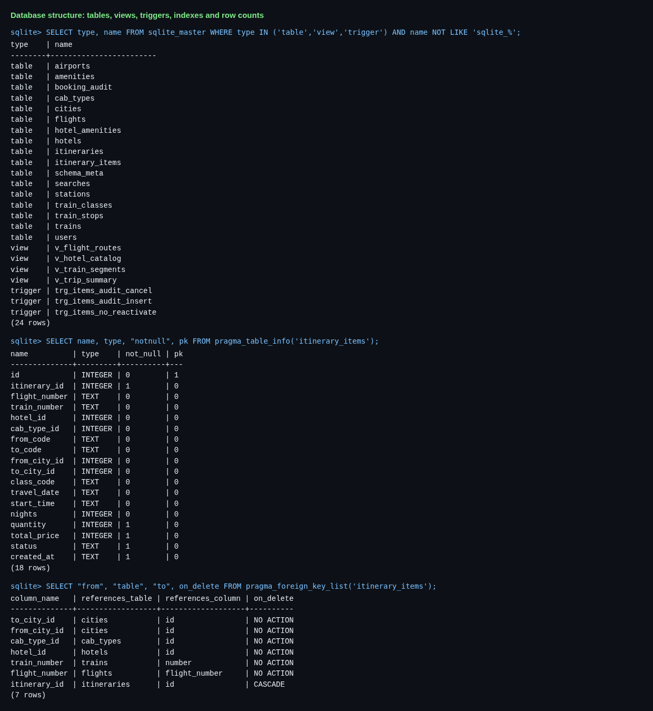

### 9.2 Sample records

Trip summary view, the six bookings of the demo journey, the audit log written by triggers, and catalog rows:

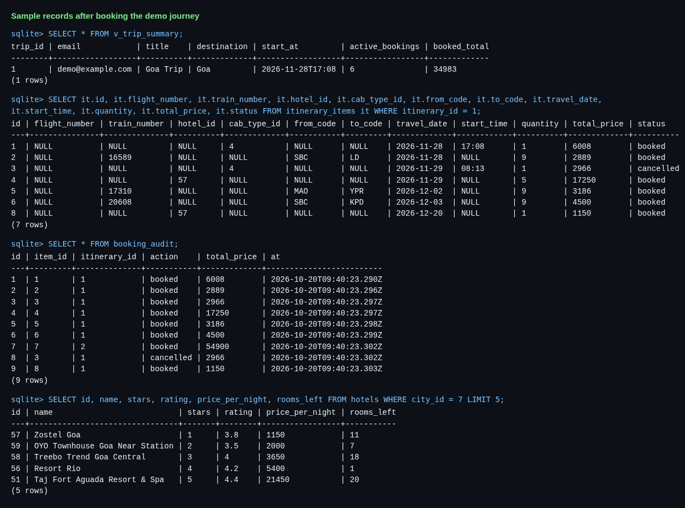

### 9.3 Execution of important queries

A JOIN (self-join of `train_stops`), an aggregate with GROUP BY/HAVING and a relational-division subquery:

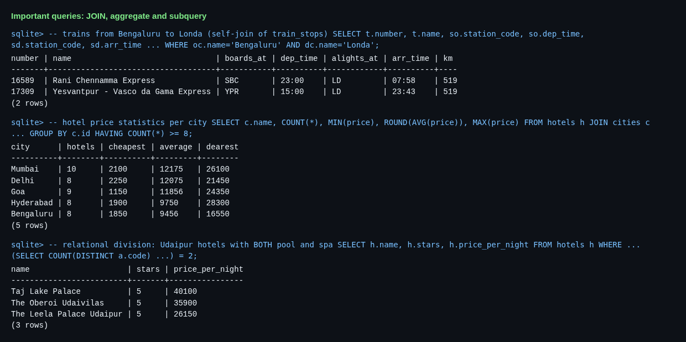

*Screenshots 9.1-9.3 are rendered captures of real `sqlite` query results; the SQL and text output are also reproduced in sections 7 and 8.*

### 9.4 Application screenshots

**Home page**


**Sign-up page** (accounts are stored in the `users` table with bcrypt hashes)

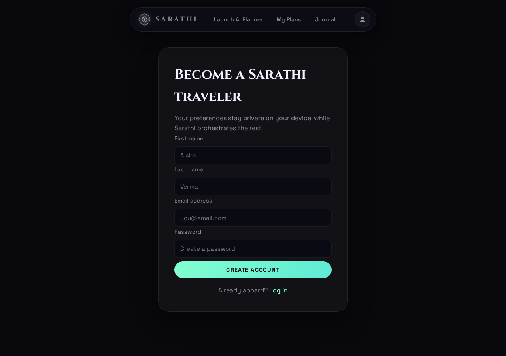

**Recommendations from the database.** The AI's JSON filters produced these ranked flights, trains, cabs and hotels for a simple one-way search.

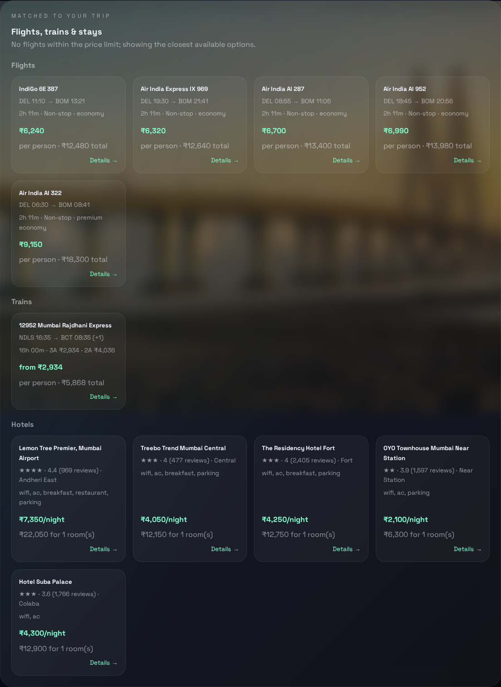

**Details and booking window.** Opened by clicking a card: full details from the database, live price, and the choice of an existing or a new named trip.

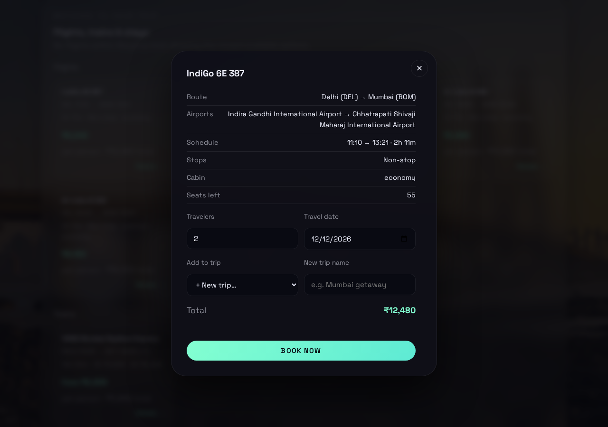

**AI itinerary, rendered as formatted text.** The written plan uses the real times from the planned journey; the card fills its box and scrolls.

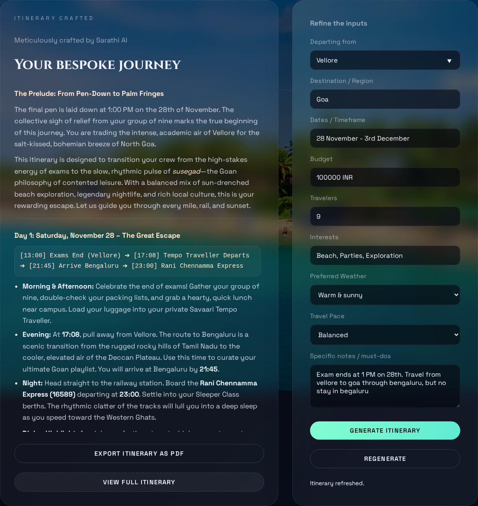

**Journey plan.** Vellore → Goa for 9 students: cab, overnight train to Londa, cab, hotel, night train back, Vande Bharat home. Each leg lists alternatives.

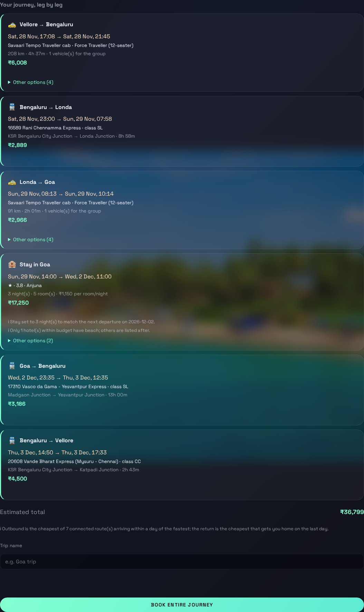

**My Trips.** One card per trip, sorted by start time.

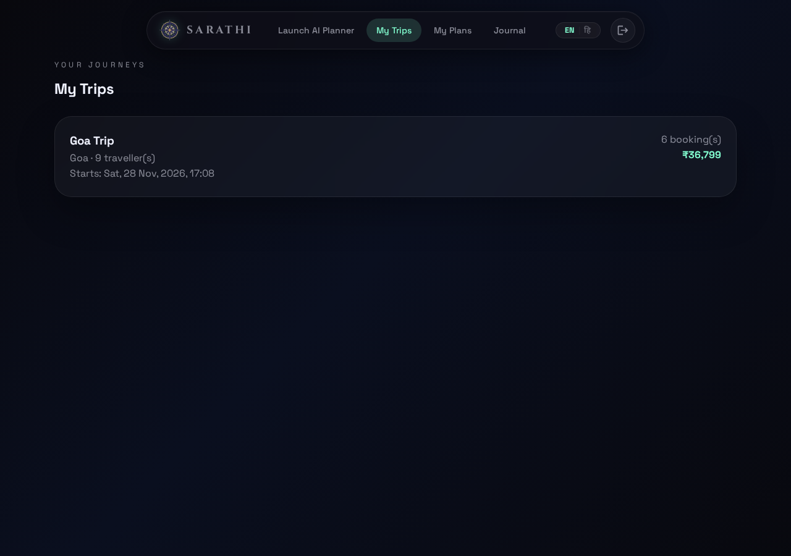

**Trip timeline and bookings.** Chronological departures, arrivals, check-ins and check-outs, then the booking cards with listing links and Cancel.

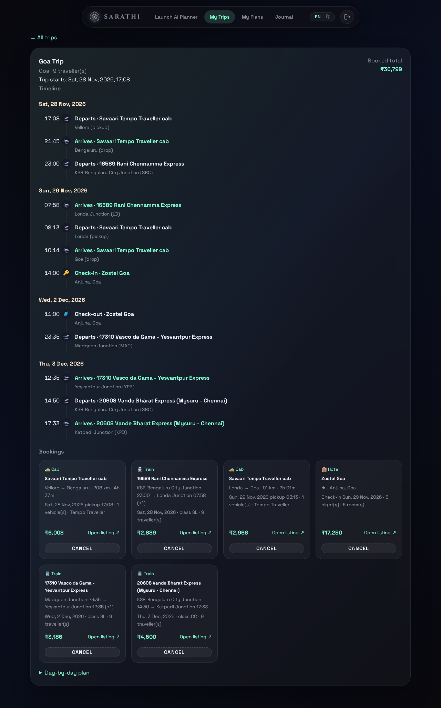

## 10. Conclusion

### 10.1 Summary of the completed project

Starting from an application that stored users in a JSON file and asked an AI for free-text plans, the project now has a
complete relational database layer: a normalised schema of 17 tables with keys, CHECK/UNIQUE/NOT NULL constraints, 10 indexes, 4 views,
3 triggers, 2 SQL functions and transactional writes, populated with a deterministic catalog of 22 cities, 324 flights,
37 trains, 140 hotels and 6 cab products. An AI returns a JSON filter that is validated and turned into parameterised SQL;
a route search composes multi-leg journeys; and users can inspect details, book items or whole journeys into uniquely named trips,
see a timeline, cancel, and follow provider links. The whole flow was verified with scripted tests and in a real browser.

### 10.2 Main features and benefits

- **Trustworthy recommendations**: every flight, fare and room shown is a database row; the AI cannot invent inventory or inject SQL.
- **Integrity by design**: foreign keys, "exactly one product per booking" CHECK, conditional stock updates, unique emails and trip names, audit triggers.
- **Real multi-modal planning**: the Vellore → Goa demo is solved as cab → train → cab → hotel → train → Vande Bharat, with no overnight stop in Bengaluru.
- **Useful trips**: many named trips per destination, automatic start time, a chronological timeline, price snapshots and cancellation that restores stock.
- **Portable and maintainable**: standard SQL, versioned migrations, deterministic seed, and documented limitations (Appendix A.9).

## 11. References

**Books**

1. A. Silberschatz, H. F. Korth, S. Sudarshan, *Database System Concepts*, McGraw-Hill. (ER modelling, normalization, transactions.)
2. R. Elmasri, S. B. Navathe, *Fundamentals of Database Systems*, Pearson. (Relational design, SQL, constraints.)
3. R. Ramakrishnan, J. Gehrke, *Database Management Systems*, McGraw-Hill.

*(Textbook entries are the standard course references for this subject; keep only those you actually consulted.)*

**Official documentation**

4. SQLite documentation: SQL language, `CREATE TRIGGER`, `CREATE VIEW`, foreign keys, WAL: https://www.sqlite.org/docs.html
5. Node.js `node:sqlite` module documentation (including user-defined functions): https://nodejs.org/api/sqlite.html
6. Express 5 documentation: https://expressjs.com/
7. OpenRouter API documentation (chat completions, JSON mode): https://openrouter.ai/docs
8. Unsplash API documentation: https://unsplash.com/documentation
9. Mermaid diagram syntax (ER diagrams): https://mermaid.js.org/
10. Playwright documentation (browser testing and screenshots): https://playwright.dev/

**Websites used for real timetable and provider data (verify before relying on them)**

11. RailMitra train schedules, e.g. https://www.railmitra.com/train-schedule/20608 (Vande Bharat 20607/20608), `.../16589` (Rani Chennamma Express), `.../17310` (Vasco da Gama - Yesvantpur)
12. ConfirmTkt train schedule 16589: https://www.confirmtkt.com/train-schedule/16589
13. ixigo train pages for 17309/17310 and 20608: https://www.ixigo.com/trains/17310
14. 24coaches, "Vande Bharat Express Trains of the Southern Region": https://24coaches.com/vande-bharat-express-trains-of-the-southern-region/
15. Official sources to confirm timetables and fares: IRCTC https://www.irctc.co.in/ and NTES https://enquiry.indianrail.gov.in/
16. Provider sites used as `listing_url` values: IndiGo, Air India, Air India Express, Akasa Air, SpiceJet, IRCTC, hotel-chain sites, Savaari, Uber Intercity.

---

## Appendix A: Implementation details

This appendix documents how the application layer was built on top of the database: the AI pipeline, the journey planner,
bookings, the API, frontend, security and testing.

### A.1 Architecture and request flow

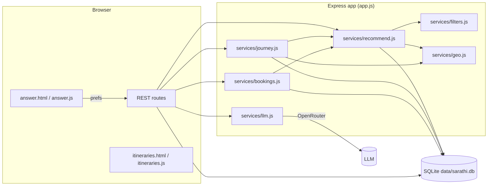

**Request flow for one search**

1. Browser posts the form to `POST /api/preferences` (session) then `POST /api/recommendations`.
2. `llm.extractFilters` asks the model for a JSON filter object (schema in `services/filters.js`). On failure it retries
   once, then falls back to rule-based extraction (`heuristicFilters`).
3. `recommend()` **sanitises** every field (whitelists, coercion, canonical city names) and runs parameterised SQL.
4. If the AI returned a `trip` object, `proposeJourney()` searches for a multi-leg route and `planJourney()` chains and
   times each leg and picks concrete options.
5. The response contains the validated filters, ranked lists, the journey plan and notes. The chosen picks are stored in
   the session and fed to the itinerary prompt so the written plan uses real times.
6. The user opens details, books a single item or the whole journey; rows land in `itineraries` / `itinerary_items`.

### A.2 AI → JSON → database recommendation pipeline

#### A.2.1 The filter contract (`services/filters.js`)

The model must reply with one JSON object matching `FILTER_SCHEMA`:
`origin`, `destination`, `date`, `nights`, `travelers`, `modes` (flight/train/cab/hotel), `budget_total_inr`,
`transport` (`max_price_inr`, `max_duration_min`, `max_stops`, `depart_after`, `depart_before`, `cabin`,
`train_classes`), `hotel` (`min_stars`, `max_stars`, `min_rating`, `max_price_per_night_inr`, `amenities`), `sort`
(best/price/duration/rating), `limit`, and an optional `trip` object (Appendix A.3).

#### A.2.2 Calling the model (`services/llm.js`)

- OpenRouter chat completions with `response_format: json_object`. The system prompt contains the schema and rules
  ("null for anything unspecified", how to interpret "luxury"/"cheap", when to fill `trip`).
- The user message carries today's date (so "28 November" resolves to the right year), the list of known cities and the
  raw preferences.
- Output is cleaned (`parseJsonObject` strips code fences/prose and takes the outermost `{...}`). Up to two attempts;
  after that `heuristicFilters` extracts dates, budget (`50k`, `1.5 lakh`), stars, amenities, "direct", "morning", etc.
  with plain rules. `SARATHI_LLM_MOCK=1` forces the heuristic path (offline testing).
- `generateItinerary` writes the day-by-day plan; when a journey exists, its legs are passed as plain-language lines
  ("Train: Bengaluru → Londa by 16589 …, departs 2026-11-28 23:00 …") and the model is told to build the plan around
  those exact times and not invent other transport.

#### A.2.3 Validation (`sanitizeFilters`)

Nothing the model says reaches SQL directly:

- Enumerations are whitelisted (modes, sorts, cabins, train classes, amenity codes); numbers are coerced and clamped;
  dates must be real calendar dates; times must match `HH:MM`.
- City text is resolved by `buildCityResolver` (name, alias, IATA code or station code, case-insensitive, first segment of
  "Goa, India") to a canonical name, or dropped.
- Unknown values become `null`/defaults. A hostile value such as `"Goa'; DROP TABLE hotels;--"` simply fails to resolve.
- All queries use bound parameters; only fixed column names and fixed SQL fragments are concatenated.

#### A.2.4 Querying and ranking (`services/recommend.js`)

| Category | Query highlights |
|---|---|
| Flights | Airports → city join; weekday via `instr(operating_days, ?)`; time-window, stops, cabin and price filters in SQL. |
| Trains | Self-join of `train_stops` (`sd.seq > so.seq`) with stations and class fares; fare computed in SQL; results grouped per train with a class/fare list. |
| Hotels | City, stars, rating, price, rooms available; amenities by **relational division** (`COUNT(DISTINCT code) = number requested`). |
| Cabs | Road distance from city coordinates; one product per cab type; vehicles = `ceil(travelers / capacity)`. |

- **Dynamic pricing (sample)**: flight price × 1.3 if departing in < 7 days, × 1.1 in < 21 days, × 0.92 beyond 60.
- **Budget caps**: when only a total budget is given, ~20% per one-way leg per person goes to transport and ~40% to hotel
  rooms per night. If a price cap empties a category, it is retried without the cap and a note explains it.
- **Ranking**: min-max normalised score. Transport: 50% price, 40% duration, 10% non-stop bonus. Hotels: 40% rating,
  35% price, 25% stars. `sort=price|duration|rating` overrides the score.
- Every request is logged in `searches` with the validated filters and result counts.

### A.3 Multi-leg journey planner

Added so a request like *Vellore → Goa, exam ends 1 PM on the 28th, through Bengaluru, no stay there, back by 3 Dec*
produces a complete connected plan. Code: `services/journey.js`; constants in the file header.

#### A.3.1 Division of labour

The LLM supplies **constraints only**, in an optional `trip` object: `return_home`, `earliest_start`, `arrive_by`, `via`
(cities to pass through) and `prefer` (cheapest/fastest). The server designs the legs deterministically, so results are
repeatable and checkable against the database. (An earlier design let the model write the legs itself; on the demo input
it chose a flight, ignoring the budget, so it was replaced.)

#### A.3.2 Route search (`proposeJourney`)

A time-expanded, level-by-level label search over trains, flights and cabs:

- **State**: label = (city, arrival time, cost, legs, visited cities). A label is dropped when another in the same city is
  no later and no dearer. Cities are never revisited; at most 4 legs; no cab directly after a cab.
- **Edges**: train segments (every later stop on the same train, cheapest class), flights (seats must cover the group),
  and cabs to any city within 450 km (cheapest vehicle mix).
- **Connection rules**: minimum gap after arrival: train 75 min, flight 120 min, cab 15 min. Layovers capped at
  8 h and may **not cross midnight**, so there are no overnight stops in transit cities. This is what satisfies "no stay
  in Bengaluru". The first leg may wait up to 18 h (e.g. hotel check-out at 11:00 for a 23:35 train).
- **Outbound choice**: among routes that pass through any required `via` city, keep those arriving within 24 h of the
  fastest (or the fastest only when `prefer = fastest`) and take the **cheapest**.
- **Return choice**: for each possible departure day from the destination, search routes arriving home before
  `arrive_by`; prefer plans that arrive **on the last day**, then the lowest `transport + nights × cheapest room rate`;
  ties go to the later arrival.
- The result is an ordered list of legs: outbound legs, a hotel leg (check-in = arrival date), return legs.

#### A.3.3 Timing and option selection (`planJourney`)

The legs are then walked in order with a cursor (the traveller's next free moment):

- **Train/flight legs**: look up options on the leg's date, drop any departing before `cursor + buffer`, rank, and pin the
  exact train or flight the search chose. Alternatives (up to 5) are kept for the UI.
- **Cab legs**: pickup is computed after the whole walk. A cab that precedes a train/flight is **retimed to leave as late
  as possible while still arriving a station-buffer (75 min train, 120 min flight) early**, never before the traveller is free.
- **Hotel legs**: nights are **derived from the next dated leg** (the model's number is only a fallback). The nightly cap is
  `(budget − estimated transport) × 0.9 / nights / rooms` (floor: 20% of budget). If the requested amenities leave fewer
  than three hotels, the next best hotels are appended and a note says so.
- **Checks**: each leg must start where the previous one ended; deadlines are verified; failures become notes rather than being hidden.
- Output: legs with options, chosen option, departure/arrival times, total, start/end, notes, and `summarizeJourney` text
  for the itinerary prompt.

#### A.3.4 Worked example (the demo input)

Input: Vellore → Goa, 28 Nov – 3 Dec, ₹1,00,000, 9 travellers, "Exam ends at 1 PM on 28th … through Bengaluru, but no stay
in Bengaluru". The planner returned the same plan on every run:

| # | Leg | Option | Departs → arrives | Cost |
|---|---|---|---|---|
| 1 | Vellore → Bengaluru | Savaari Tempo Traveller cab (1 vehicle) | 28 Nov 17:08 → 21:45 | ₹6,008 |
| 2 | Bengaluru → Londa | 16589 Rani Chennamma Express, SL | 28 Nov 23:00 → 29 Nov 07:58 | ₹2,889 |
| 3 | Londa → Goa | Savaari Tempo Traveller cab | 29 Nov 08:13 → 10:14 | ₹2,966 |
| 4 | Stay in Goa | Zostel Goa, 5 rooms, 3 nights | 29 Nov 14:00 → 2 Dec 11:00 | ₹17,250 |
| 5 | Goa → Bengaluru | 17310 Vasco da Gama – Yesvantpur Express, SL (from Madgaon) | 2 Dec 23:35 → 3 Dec 12:35 | ₹3,186 |
| 6 | Bengaluru → Vellore | 20608 Vande Bharat, CC | 3 Dec 14:50 → 17:33 (Katpadi) | ₹4,500 |

Total ≈ ₹36,799. The hotel is a hostel because "Beach" is a hard amenity filter and only one hotel inside the remaining
budget matches; two others are listed as alternatives.

### A.4 Bookings, trips and the timeline

Code: `services/bookings.js`; UI: `public/js/answer.js` (booking) and `public/js/itineraries.js` (trips).

#### A.4.1 Details

`GET /api/details/:type/:ref` returns the full record for the details window: flight airports/seats; train **every stop**
with times/distances and per-class fares for the chosen segment; hotel full amenity list; cab vehicle, distance and
vehicles needed. Prices are recomputed for the requested travellers/date/nights.

#### A.4.2 Booking rules

Everything is validated and priced **on the server**; the client only says *what* and *when*:

- A travel date is required, valid and not in the past; flights/trains must operate on that weekday.
- Flights decrement `seats_left` with `UPDATE ... WHERE seats_left >= ?`; hotels decrement `rooms_left` the same way, so
  overbooking is impossible even with concurrent requests. Insufficient stock returns HTTP 409.
- Train bookings check the station order (boarding before alighting) and the class.
- Cab bookings need pickup/drop cities and a `HH:MM` pickup time.
- Single bookings run in one transaction; **batch** bookings (`/api/bookings/batch`) book every leg of a journey in one
  all-or-nothing transaction.
- `DELETE /api/bookings/:id` marks the item cancelled, restores seats/rooms and recomputes the trip start. Only the owner can cancel.

#### A.4.3 Trips (itineraries)

- Users can create **many trips to the same destination**. Each has a **unique name chosen by the user** (case-insensitive).
  A blank name is rejected; a duplicate returns HTTP 409.
- In the details window the user picks an existing trip or **+ New trip…** and types a name. "Book entire journey" asks for a name too.
- The AI-written plan text from the session is attached to a trip when its destination matches, so My Trips can show it.
- `itineraries.start_at` = earliest departure/check-in among active bookings, recomputed after every booking and cancellation.

#### A.4.4 The timeline

For each active booking the server generates events and sorts them chronologically:

| Booking | Events |
|---|---|
| Flight | departure at `date + dep_time`; arrival at `date + arr_time (+1 day if overnight)` |
| Train | departure at the boarding station; arrival at the alighting station with the correct day offset |
| Cab | pickup at `start_time`; drop at pickup + duration (road km ÷ 45 km/h) |
| Hotel | check-in 14:00; check-out 11:00 after the last night |

The My Trips page shows these grouped by day with icons, plus the booking cards (price, "Open listing ↗", Cancel) and the AI plan.

#### A.4.5 Provider redirect

After a single **Book now**, the browser opens a tab on the item's `listing_url` (opened synchronously in the click handler
so pop-up blockers allow it, then pointed at the provider) while the current tab goes to the trip page. If the tab is blocked,
only the trip page opens. Every booking card has an **Open listing** link.

### A.5 HTTP API reference

| Method & path | Auth | Purpose |
|---|---|---|
| `POST /api/signup`, `POST /api/login`, `POST /api/logout`, `GET /api/session` | - | Accounts (now stored in SQLite; emails normalised to lower case). |
| `POST /api/preferences`, `GET /api/preferences` | - | Session form data, now including `origin`. |
| `POST /api/recommendations` | - | AI filters → ranked flights/trains/cabs/hotels and, when applicable, the journey plan. |
| `POST /api/itinerary`, `GET /api/itinerary/latest` | - | Generate / fetch the AI day-by-day plan (uses the real picks). |
| `GET /api/cities` | - | City names for the origin autocomplete. |
| `GET /api/details/:type/:ref` | - | Full record for the details window (`type` = flight/train/hotel/cab). |
| `POST /api/bookings` | login | Book one item: `type`, `ref`, `date`, plus `itinerary_id` **or** `new_trip_name`. |
| `POST /api/bookings/batch` | login | Book several items into one trip, atomically. |
| `DELETE /api/bookings/:id` | login | Cancel and restore inventory. |
| `GET /api/itineraries[?summary=1]` | login | Trips with bookings and timelines (summary: id/title/destination/start only). |
| `GET /api/destination-media`, `GET /api/unsplash` | - | Unchanged (Unsplash proxy). |
| `GET /itineraries` | - | The My Trips page (redirects to login if the API returns 401). |

Error handling: `BookingError` carries an HTTP status (400 validation, 404 not found, 409 conflict/stock); unexpected
errors return a generic 500 and are logged.

### A.6 Frontend changes

- **Planner (`answer.html` / `answer.js`)**: "Departing from" field with a city datalist; itinerary card that fills its box and scrolls;
  Markdown rendering; recommendations section; clickable cards → details modal (travellers, date, nights, class, pickup
  time, trip chooser, live price); journey section (leg cards, per-leg alternatives with a connection warning, total, trip name, **Book entire journey**).
- **Markdown (`public/js/markdown.js`)**: a small DOM-building renderer for headings, bold, italic, code, bullet and numbered
  lists, rules and paragraphs. It uses `textContent` only, never `innerHTML`, so model output cannot inject markup. It is shared by the planner, the full-itinerary modal and My Trips.
- **Layout fix**: the card used `max-height: 420px` while the form column was taller. It now uses `height: 0; min-height: 100%` so it fills the
  row without stretching it, and the content area scrolls; on narrow screens it falls back to a normal flow.
- **My Trips (`itineraries.html` / `itineraries.js`)**: trip cards sorted by start time, hash routing (`#trip-<id>`), timeline, bookings, plan.
- **Fixes along the way**: a wrong SRI hash that blocked the html2pdf script (so PDF export never loaded); the "generated by GPT-5-mini" label
  was removed (the model is configurable).
- **i18n**: new English and Hindi keys for the origin field, recommendations header, My Trips link/page. The journey, cab and booking
  strings are English only for now.

### A.7 Security and integrity

- **SQL injection**: bound parameters everywhere; whitelisting of every AI/client-supplied enum; identifiers are never interpolated from user input.
  Tested with malicious city names, amenities, stars, times, sort keys, booking refs and nights.
- **XSS**: all model and database text is inserted with `textContent`/DOM APIs.
- **Passwords**: bcrypt hashes retained; login errors are generic.
- **Authorisation**: bookings, trips and cancellation are scoped to the session user; foreign trip ids return 404.
- **Concurrency and consistency**: stock decrements are conditional updates inside transactions; batch bookings are all-or-nothing;
  uniqueness is enforced by the database, not just the UI.
- **Secrets**: `.env` is git-ignored; keys were validated without printing them. `SARATHI_SESSION_SECRET` should be changed from the placeholder before deployment.

### A.8 Testing and verification

All tests ran against scratch databases (`SARATHI_DB_PATH`) and alternate ports so the live database was not touched.

| Area | What was checked |
|---|---|
| Seed | Row counts, deterministic reload, `PRAGMA foreign_key_check` clean, CHECK constraint rejects a 9-star hotel. |
| Auth | Signup, duplicate/case-variant email, bad login, login, logout; legacy `users.json` import. |
| Filters | Departure window, train class, stars, amenities (relational division), price caps and relaxation, return-direction train matching, intermediate-stop boarding. |
| Injection | Malicious strings in every filter and booking field; tables stayed intact. |
| Real model | Key validity (OpenRouter, Unsplash), invalid model id detected, real filter extraction, itinerary generation using real picks. |
| Bookings | Flight/hotel/train/cab booking, wrong class, reversed route, past date, overbooking (409), injection in `nights`/`ref`, duplicate trip name, same-destination second trip, cancellation restoring stock, trip start recomputed. |
| Timeline | Chronological order across days, overnight arrivals, hotel check-in/out, cab legs. |
| Migrations | v1 → v2, v2 → v3 (with duplicate/blank titles), v3 → v4 (with existing bookings), live-database copy, `foreign_key_check`. |
| Demo scenario | The Vellore → Goa input run through the real model repeatedly; identical six-leg plan every time (Appendix A.3.4). |
| Browser | Playwright (Chromium): markdown rendering and card fill at 1280 px and 600 px; a full run: sign up, fill the form, generate, book the entire journey with a trip name, land on the trip page, read the timeline and booking cards. Screenshots reviewed. |
| Views, triggers, SQL functions | The four views return expected rows; the audit triggers log booking and cancellation; re-activating a cancelled booking is rejected; `road_km`/`cab_minutes` match the application's cab quotes (208 km, 277 min for Vellore → Bengaluru). |
| Transactions | A deliberately invalid insert inside `BEGIN … ROLLBACK` restored the hotel's `rooms_left`; a `COMMIT` made both changes permanent together (section 8.4). |
| Constraint attempts | UNIQUE (email, trip name), CHECK (stars, one-product rule), FOREIGN KEY and NOT NULL violations are all rejected by the database (section 8.5). |

### A.9 Known limitations and next steps

- **Sample data**: fares, prices, ratings, seats and most train times are generated. Verify the five real timetables on IRCTC/NTES.
- **Listing links** go to provider sites, not specific flights/rooms; real deep links need partner/affiliate access.
- **Yesvantpur vs KSR Bengaluru**: train 17310 ends at Yesvantpur; the planner treats both as "Bengaluru" and assumes the transfer fits in the 75-minute rail buffer.
- **No payment or provider confirmation**; "booking" records the plan and reserves sample inventory.
- **Sessions** use the default in-memory store (lost on restart; not for production). No CSRF protection or rate limiting.
- **Search model**: one-way segments only except the journey planner's return leg; no multi-city (>1 destination) trips; hotel check-in/out times are fixed assumptions (14:00/11:00).
- **Cab model**: straight-line distance × 1.25 and 45 km/h; no tolls, night charges or driver allowances.
- **Hindi translations** for the journey, cab and booking UI are still to be added.
- **Ideas**: deep links via partner APIs, editable trips (rename, move a booking, reschedule), real-time availability, PostgreSQL deployment (the schema is portable), automated test suite and CI (verification so far has been scripted and manual).
- **Stored procedures**: SQLite has none; the equivalent logic is in transactional application functions and two SQL user-defined functions (section 8.3).
- **Normalization**: `flights` repeats `airline_code`/`airline_name` (a transitive dependency); a separate `airlines` table would remove it (section 5.5).

### A.10 File map

| Path | Role |
|---|---|
| `app.js` | Express routes (auth, preferences, recommendations, details, bookings, trips, itinerary). |
| `db/schema.sql` | Full relational schema. |
| `db/index.js` | Connection, PRAGMAs, migrations (v1-v4), auto-seed, legacy user import, user repository. |
| `db/seed-data.js`, `db/seed.js` | Reference data and deterministic generator; `npm run seed`. |
| `services/filters.js` | Filter schema shown to the LLM, sanitiser, `trip` sanitiser, heuristic fallback. |
| `services/llm.js` | OpenRouter client, filter extraction with retry/fallback, itinerary generation. |
| `services/recommend.js` | City resolver, flight/train/hotel/cab queries, pricing, ranking, relaxation. |
| `services/journey.js` | Route search, journey timing and option selection, itinerary summary. |
| `services/bookings.js` | Details, booking, batch booking, cancellation, trips, timeline, start-time maintenance. |
| `services/geo.js` | Haversine distance, road factor, cab duration, cab range. |
| `public/answer.html`, `public/js/answer.js` | Planner UI, details modal, journey UI. |
| `public/itineraries.html`, `public/js/itineraries.js` | My Trips page. |
| `public/js/markdown.js` | Safe Markdown renderer. |
| `public/css/styles.css` | Styles for all of the above. |
| `public/i18n/en.json`, `hi.json` | Added keys. |
| `README.md` | Short run/usage guide. |
| `report.md` | This document. |
| `docs/screenshots/` | Screenshots used in section 9. |
| `report.md` | This document. |
